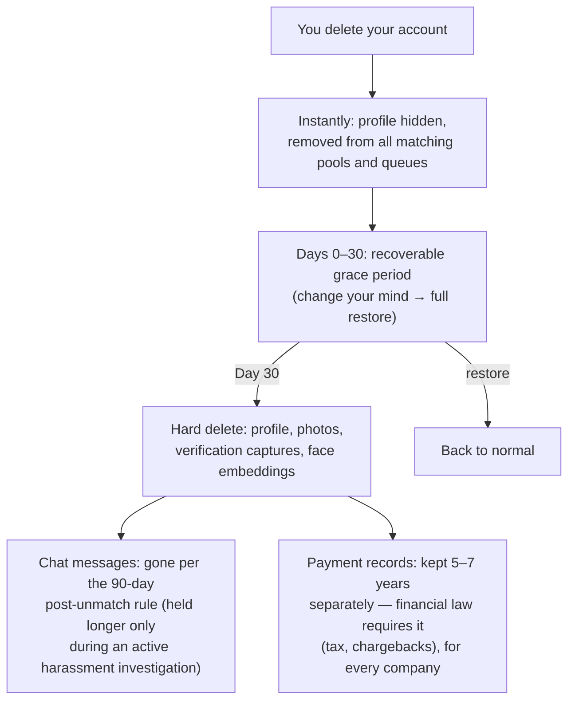

# How Sincère Works — End to End

> A complete walkthrough of the application for both technical and non-technical readers. Every formula, algorithm, and model is explained **in plain English first**, then technically. Deeper engineering detail lives in [TECHNICAL_IMPLEMENTATION_PLAN.md](TECHNICAL_IMPLEMENTATION_PLAN.md); the big-picture design in [ARCHITECTURE_PLAN.md](ARCHITECTURE_PLAN.md).

---

## Table of Contents

1. [The Idea in One Paragraph](#1-the-idea-in-one-paragraph)
2. [The User Journey](#2-the-user-journey)
3. [Authentication — Proving You're You](#3-authentication--proving-youre-you)
4. [The Waitlist & Admission System](#4-the-waitlist--admission-system)
5. [The Matching Process](#5-the-matching-process)
6. [The Recommendation Engine](#6-the-recommendation-engine)
7. [Ranking Formulas, Explained](#7-ranking-formulas-explained)
8. [AI & Machine-Learning Models](#8-ai--machine-learning-models)
9. [A Request's Complete Lifecycle](#9-a-requests-complete-lifecycle)
10. [Frontend Flow](#10-frontend-flow)
11. [Backend Flow & Database Interactions](#11-backend-flow--database-interactions)
12. [APIs — The App's Vocabulary](#12-apis--the-apps-vocabulary)
13. [Real-Time Communication & Notifications](#13-real-time-communication--notifications)
14. [Background Jobs — The Night Shift](#14-background-jobs--the-night-shift)
15. [Security](#15-security)
16. [Privacy & Data Flow](#16-privacy--data-flow)

---

## 1. The Idea in One Paragraph

Most dating apps are roughly 70% men and 30% women, which ruins the experience for everyone. Sincère fixes this structurally: in every local area, the app **only admits new men when there are enough active women** to keep the ratio at one-to-one. Men who can't get in yet join a waitlist — they can wait for free, pay a fixed price to move faster, or bid in a once-a-day auction. Once inside, everyone gets the same treatment: **15 carefully chosen profiles a day**, picked by an algorithm that learns what you like, predicts who will like you *back*, and — eventually — learns from whether people actually met in real life. Paying never buys better matches, only earlier entry.

---

## 2. The User Journey

### For a woman

1. **Sign up** — phone number, profile, prompts, interests.
2. **Verify** — a short selfie video with random instructions ("blink," "turn your head") proves she's a real, live person.
3. **Enter immediately** — women are never waitlisted; the whole system exists to protect their experience.
4. **Get 15 matches a day** — from people within a distance she chooses herself (a 1–100 km slider).
5. **Swipe, match, chat** — all in-app.
6. **Later:** if she and a match talk a lot, the app eventually asks, privately, "did you two meet in person?" — the answer quietly improves matching for everyone.

### For a man

Steps 1–2 are identical. Then:

3. **Admission check** — if his area's ratio has room (roughly: active men below ~90–95% of active women), he's in. Otherwise:
4. **The waitlist** — three ways forward:
   - **Free (60% of daily openings):** wait; genuine engagement moves you up faster than pure queue order.
   - **Paid (25%):** a one-time fixed price for a faster lane. No surge pricing, ever.
   - **Auction (15%):** a live, once-daily bidding window; highest bidders when it closes win that day's auction spots.
5. **Once admitted, total equality** — a decided rule: how you entered has zero effect on your match scores. The app never shows women worse matches to reward men who paid.

```mermaid
flowchart LR
    S[Sign up] --> V[Liveness verification]
    V --> G{Woman?}
    G -->|Yes| IN[Active immediately]
    G -->|No| R{Room in area's ratio?}
    R -->|Yes| IN
    R -->|No| W[Waitlist: free / paid / auction]
    W --> IN
    IN --> D[15 matches daily] --> SW[Swipe] --> M[Match] --> C[Chat] --> WM["We Met?" prompt<br/>(rolls out shortly after launch)]
```

---

## 3. Authentication — Proving You're You

**Plain English:** signing up takes two proofs. First, a code texted to your phone proves you own that number. Second — and this is where Sincère goes further than most — a short selfie video with *random* instructions proves you're a live human, not a photo of someone else or an AI-generated face. The randomness matters: a fraudster can't pre-record a video if they don't know which instructions are coming. The app then converts your face into a *mathematical fingerprint* (a list of numbers — see [§8](#8-ai--machine-learning-models)) and checks it against every existing user, so one person can't run five accounts. It also checks that your profile photos are actually of the person in the verification video — blocking the classic scam of verifying with your real face, then swapping in a model's photos.

**Technical:** phone-OTP signup issues limited-scope JWTs; the liveness pipeline (randomized prompt sequence → FaceNet embedding via DeepFace → Atlas Vector Search duplicate query → photo-to-selfie match → device/behavioral signals) produces a **composite bot-risk score** routed into three bands: auto-approve, auto-reject, or human review (only the genuinely ambiguous middle — a few percent, reviewed in-house by the founder at launch). Duplicate rule: **>90% cosine similarity flags for human review** — never an automatic ban, because false positives (identical twins, bad lighting) are real. Token scopes track lifecycle state, so a waitlisted man's token physically cannot call matching or chat endpoints. Details: [TECHNICAL_IMPLEMENTATION_PLAN.md §5](TECHNICAL_IMPLEMENTATION_PLAN.md#5-authentication-flow).

---

## 4. The Waitlist & Admission System

### How the app divides the map

**Plain English:** the app divides all of India into a honeycomb of equal hexagons, each about 36 km² (H3 "resolution 6" — a standard open-source grid from Uber). Your hexagon is decided purely by where you are — no fuzzy city borders, no gaps, and the lines never move. Each hexagon runs its own independent ratio count and waitlist. Why hexagons instead of "cities"? Because official city boundaries leave most of rural India in no region at all, and machine-drawn clusters shift as people join — which would silently corrupt the very counts the ratio depends on.

**Crucially, the hexagon only controls *admission*.** Who you actually see each day is controlled by a completely separate thing: **your own distance slider (1–100 km)** from wherever you last opened the app. Two systems, deliberately independent.

### Who counts as "active"

**Plain English:** the ratio counts people actually *using* the app — logged in within the last 30 days **and** having swiped at least once in that time. Merely opening the app doesn't count; otherwise abandoned accounts would inflate the numbers and quietly break the 1:1 promise.

### The thermostat: hysteresis

**Plain English:** the admission rule works like a thermostat with a comfort zone. If it switched at exactly 1.00, ordinary daily fluctuation would flip admissions on and off constantly. Instead: stop admitting men when active men reach **105%** of active women; don't resume until women recover past **95%**. The gap between the two thresholds prevents flapping. Two more safeguards: men are only admitted up to **90–95%** of the women's count (a safety margin so normal churn doesn't force reactions), and — an ironclad rule — **nobody already inside is ever kicked out** when the ratio dips. Only new admissions pause.

**Technical:** per-hex counters (`active_men`, `active_women`) are event-maintained (`ActiveStatusChanged`) with an hourly full-recount backstop; the hysteresis state machine (`open`/`frozen`) gates daily slot issuance, split 60/25/15 across free/paid/auction tiers. All thresholds are config-tunable launch defaults, flagged for refinement against real churn data.

### Keeping women from leaving in the first place

**Plain English:** since everything depends on active women, the app watches for early warning signs that a woman is drifting away — fewer sessions, fewer messages, slower replies — and flags her for proactive win-back *before* she quits, rather than noticing after.

---

## 5. The Matching Process

**Plain English:** every day, the app hand-builds you a set of 15 profiles (more on paid plans: ~30 on Basic Pro, 40+ on Pro Plus). It's not a random sample and not an endless feed — it's a ranked selection from everyone who is: active, verified, within *your* chosen radius, has *you* within *their* radius, and hasn't already been shown to you. The ranking blends several questions: How much do your stated interests overlap? Are your age and distance sensible? **Would this person actually like you back?** (the single most important question, and the one most apps under-build). Do people with taste like yours tend to like this person? Is this person actually responsive to their matches right now, or do they leave conversations on read? A small deliberate dose of variety is mixed in so the same "popular" profiles don't monopolize everyone's day.

Swiping is watched for abuse, not for ranking: if someone right-swipes almost everything after glancing under 10 seconds (on more than 70% of their right-swipes), they get a warning; after three warnings on separate occasions, a ban. Being *decisive* isn't punished with worse matches — spamming is treated as conduct, handled by warnings.

**Technical:** the nightly batch per user runs pool query (geo, bidirectional radius, exclusions) → feature assembly (cached vectors) → scoring ([§7](#7-ranking-formulas-explained)) → exploration injection (~40% of slots pre-graduation, ~15% after) → persist ordered batch; `GET /matches/daily` is then a pure lookup. Full pipeline: [TECHNICAL_IMPLEMENTATION_PLAN.md §11](TECHNICAL_IMPLEMENTATION_PLAN.md#11-matching-algorithm).

---

## 6. The Recommendation Engine

**Plain English — the three ages of a user:**

1. **Newcomer ("cold start").** The app knows nothing about your behavior yet, so it relies on what you *told* it: your interests, your age/distance basics, and the vibe of your written answers. It also deliberately shows you a wider variety (about 40% exploratory picks) — partly for you to discover your taste, partly for the app to learn it.
2. **Graduate.** After **20 swipes and 3 matches**, you "graduate": the app now has real evidence of what you like and starts blending in its learned models. The blend is gradual — no sudden personality change in your recommendations.
3. **Established.** The learned models dominate: like-back prediction, taste-similarity, current responsiveness, plus small bonuses for new users (so newcomers aren't buried) and a modest visual-taste signal ([§8](#8-ai--machine-learning-models)). Exploration drops to ~15% — still some serendipity, never a filter bubble.

And one loop most apps don't have: the **"We Met" feedback loop** (adapted from Hinge, credited in the decision record). After a genuinely substantial conversation — **20–30 messages within 3 days** — the app privately asks each person whether they met in real life and whether it was good. If "not yet," it politely re-asks every week or two until they've met or unmatched. Those answers become *ground truth*: the models get retrained not on "who got swiped on" (which only measures profile appeal) but on "which pairings actually worked in the real world."

---

## 7. Ranking Formulas, Explained

Each formula in plain English first, then the math. Weights below are the decided structure with illustrative values — the record fixes only the 0.05 visual weight; the rest get tuned on real data.

### The newcomer score (`cold_start_score`)

**Plain English:** with no behavior to learn from, score a candidate by three things you can compute from profiles alone: how much your stated interests overlap (worth 45%), how reasonable the age gap and distance are (30%), and how similar the *themes* of your written answers feel (25%).

```
cold_start_score = 0.45 × preference_similarity
                 + 0.30 × demographic_fit
                 + 0.25 × prompt_text_similarity
```

- `preference_similarity` — **plain:** how much your interest lists overlap, as a 0-to-1 number. **Technical:** cosine similarity between the two users' interest/lifestyle tag vectors.
- `demographic_fit` — **plain:** a sanity score for age gap and distance — closer and more age-compatible scores higher. **Technical:** a normalized 0–1 function of age difference and geographic distance.
- `prompt_text_similarity` — **plain:** do your written answers sound like you'd get along? **Technical:** cosine similarity between text embeddings of the two users' prompt answers.

### The established score (`final_score`)

**Plain English:** once the app knows you, the biggest single factor (35%) is *whether this person would like you back* — mutual interest is the whole point. Next (25%): people whose taste resembles yours tended to like this person. Your stated interests still matter (20%). Then: is this person currently an engaged, responsive user (10%)? A small boost if they're new to the app (5%), and a small nudge if they resemble the kind of faces you've liked before (5%, deliberately tiny).

```
final_score = 0.35 × reciprocity_prediction
            + 0.25 × collaborative_filtering
            + 0.20 × preference_similarity
            + 0.10 × engagement_score
            + 0.05 × freshness_boost
            + 0.05 × visual_pattern_similarity    ← fixed by decision
```

- `reciprocity_prediction` — **plain:** the app's estimate of the odds this candidate would swipe right on *you*. **Technical:** output of a gradient-boosted-trees classifier ([§8](#8-ai--machine-learning-models)).
- `collaborative_filtering` — **plain:** "users who liked what you like also liked this person." **Technical:** matrix-factorization affinity from platform-wide swipe history ([§8](#8-ai--machine-learning-models)).
- `engagement_score` — **plain:** is this person actually showing up for their matches right now? Someone who replies promptly scores high; someone leaving matches unread decays. Recent behavior counts more than old. **Technical:** recency-weighted per-match score from chat message counts and response latency; the same underlying data feeds churn-risk flagging.
- `freshness_boost` — **plain:** new users get temporary extra visibility so they aren't invisible behind established profiles; it fades over time. **Technical:** a decay function of days-since-signup.
- `visual_pattern_similarity` — **plain:** a gentle "resembles the kind of faces you've liked" nudge — like Netflix using your watch history, and emphatically *not* a beauty score ([§8](#8-ai--machine-learning-models)). **Technical:** cosine similarity of face embeddings vs. your liked-profiles history; capped above 0.95 similarity (that high usually means a duplicate or a relative, not a preference); defaults to neutral 0.5 until you have enough like-history.

### The transition (`blended_score` and `confidence`)

**Plain English:** graduation isn't a switch-flip. The app mixes the newcomer score and the learned score, gradually shifting trust to the learned one. The trust curve rises *fast* at first then levels off — because your first post-graduation swipes teach the model the most, and each later swipe adds a little less.

```
blended_score = confidence × final_score + (1 − confidence) × cold_start_score
confidence    = a diminishing-returns (logarithmic) curve of post-graduation swipes, → 1.0
```

### The anti-spam ratio (`swipe_ratio`) — not a ranking input

**Plain English:** the fraction of your right-swipes that came after glancing at a profile for under 10 seconds. Above ~70% over a rolling window → warning; three warnings on separate occasions → ban. It never touches your match scores — it's a conduct rule, not a ranking penalty.

---

## 8. AI & Machine-Learning Models

### Face embeddings — FaceNet (via DeepFace)

**Plain English:** the app converts a face photo into a list of numbers — a mathematical fingerprint. Two photos of the *same* person produce very similar number-lists even across lighting and angles. Critically, the numbers are **not** measurements of features — there is no "jawline score" anywhere, by explicit design (that would be both legally worse under biometric-privacy laws and ethically the beauty-scoring pattern the product rejected outright). The fingerprints are compared only by overall similarity, for exactly two purposes: catching duplicate accounts at signup, and the small personal visual-taste signal. **Never for marketing, never as a universal attractiveness rating** — the same person gets a *different* visual-pattern score in different viewers' feeds, because it's relative to each viewer's own history. FaceNet was chosen specifically for its clean commercial license (alternatives like InsightFace restrict their pretrained models to non-commercial use); an accuracy trade-off vs. the state of the art was accepted knowingly, and the DeepFace wrapper makes the model swappable by config later.

**Technical:** 512-d embeddings; cosine similarity via MongoDB Atlas Vector Search (no separate vector DB); source images discarded after embedding; the >0.95-similarity cap on the visual signal doubles as the accepted mitigation for the relatives-resemble-each-other problem (a dedicated relative-exclusion system was considered and permanently dropped as disproportionate).

### Reciprocity prediction — gradient-boosted trees (XGBoost/LightGBM)

**Plain English:** imagine thousands of tiny decision-makers, each asking simple questions ("do they share 3+ interests?", "is the distance under 10 km?", "how active are they?"), each slightly correcting the previous one's mistakes. Together they output a probability: *will this candidate like this user back?* This family of model was chosen over fancier neural approaches because neural networks need mountains of data a new app doesn't have — the classic mistake is buying a race car before there's a road.

**Technical:** GBT classifier over pairwise features (shared interests, distance, activity, chat-derived engagement); retrained in periodic batches; the heaviest-weighted signal (0.35) in `final_score`.

### Collaborative filtering — matrix factorization (SVD/ALS)

**Plain English:** picture a giant grid — every user down the side, every profile across the top, likes/passes in the cells (mostly blank). Matrix factorization discovers a small set of hidden "taste dimensions" that explain the filled-in cells, then uses them to predict the blanks: "people whose likes resemble yours also liked this profile." Nobody defines the taste dimensions — they emerge from the data.

**Technical:** SVD/ALS latent-factor model over the swipe matrix; affinity = dot product of user/item factors; retrained in the same batch cadence; chosen over neural CF/GNNs for the same data-volume reasoning.

### Churn-risk flagging

**Plain English:** an early-warning system, not a matchmaking model: falling session counts, fewer messages, slower replies → flag as at-risk (women prioritized, since their activity is the system's ceiling) → proactive win-back rather than a post-mortem.

**Technical:** rule-based at launch on session + chat aggregates; a learned model is a natural later upgrade.

### The retraining loop

**Plain English:** every week or month (cadence to be set by data volume), the models are retrained on accumulated swipes, chats, and — most valuably — "We Met" answers. Each new model must beat the current one on held-back test data before going live; if it doesn't, the old model stays. Batch retraining was deliberately chosen over live continuous learning: easier to validate, impossible to quietly drift wrong on a trickle of noisy survey responses.

---

## 9. A Request's Complete Lifecycle

What happens in the seconds after a user opens the app in the morning:

```mermaid
sequenceDiagram
    autonumber
    participant U as User's phone
    participant GW as API gateway
    participant API as Backend (monolith)
    participant R as Redis (cache)
    participant DB as MongoDB

    U->>U: app opens → capture GPS once
    U->>GW: POST /me/location (JWT attached)
    GW->>API: authenticated request
    API->>DB: overwrite last_recorded_location<br/>(derive H3 hex; old value replaced — no history kept)
    U->>GW: GET /matches/daily
    GW->>API: validate token scope = active
    API->>R: today's precomputed batch?
    alt cache hit (normal)
        R-->>API: ordered 15
    else miss
        API->>DB: fetch from daily_batches
    end
    API-->>U: 15 profiles (boosted ones labeled)
    U->>GW: POST /swipes {target, right, dwell_ms}
    API->>DB: insert swipe; update graduation counters
    API--)API: async events: anti-abuse dwell check,<br/>match check (did they already like me?)
    alt mutual like
        API-->>U: "It's a match!" → chat opens
    end
```

**Plain English:** the expensive thinking (ranking thousands of candidates) happened overnight; the morning request just *picks up the answer*. That's why the app feels instant. The location update is a single overwrite — the app keeps only your most recent location, never a trail. The swipe write is tiny and fast; everything heavier it triggers (abuse checks, engagement updates) rides asynchronously behind the response.

---

## 10. Frontend Flow

**Plain English:** the mobile app is a thin, honest window onto the backend. It owns five behaviors that matter: capturing your location *once per app-open* (never in the background — a product decision, not an accident); timing how long you look at each profile before swiping (feeding the anti-spam system, cross-checked server-side so it can't be faked); running the liveness camera flow with server-issued random prompts; holding a live chat connection while the app is open; and rendering the mandatory **"Boosted" label** on any profile that paid for extra visibility — transparency is a decided rule, not a courtesy.

Screen map and client details: [TECHNICAL_IMPLEMENTATION_PLAN.md §4](TECHNICAL_IMPLEMENTATION_PLAN.md#4-frontend-implementation).

---

## 11. Backend Flow & Database Interactions

**Plain English:** the backend is one program organized as eight strictly-separated departments — Identity, Admission, Matching, Chat, Anti-Abuse, Monetization, ML/Feedback, Admin — each with its own filing cabinets (database collections) that *no other department may open directly*. Departments either ask each other questions through official channels or post announcements ("a message was sent," "a payment succeeded") that others react to. This discipline is what lets any department later move into its own building (become an independent service) without renovation — the full story is [ARCHITECTURE_PLAN.md](ARCHITECTURE_PLAN.md).

The single database (MongoDB) holds collections including: `users`, `embeddings` (face fingerprints only — never photos), `verification_captures`, `swipes`, `matches`, `messages`, `queues` (one document per hexagon), `subscriptions`, `bot_risk_flags`, `we_met_responses`, `device_signals`. Face-similarity search runs *inside* the same database (Atlas Vector Search) — one less system to run and secure. Every collection carries its retention rule ([§16](#16-privacy--data-flow)); schema detail in [TECHNICAL_IMPLEMENTATION_PLAN.md §8](TECHNICAL_IMPLEMENTATION_PLAN.md#8-database-schema).

---

## 12. APIs — The App's Vocabulary

**Plain English:** the phone app and the servers speak a fixed vocabulary of requests. The important nouns:

| You do this | The app says this | Server's job |
|---|---|---|
| Open the app | `POST /me/location` | Overwrite your one stored location |
| Check today's matches | `GET /matches/daily` | Hand over the precomputed, ordered batch |
| Swipe | `POST /swipes` | Record it (with view time); check for a mutual match |
| Send a message | WebSocket `/ws/chat` | Deliver live; update engagement stats |
| Check the queue | `GET /queue/status` | Your tier, position, and whether your area is admitting |
| Bid | `POST /auction/bid` | Accept only if it beats the standing requirement |
| Go Pro | `POST /pro/subscribe` | Activate via the payment provider |
| Answer "We Met" | `POST /wemet/…/response` | Store a ground-truth training label |
| Delete account | `DELETE /me` | Hide instantly; start the 30-day grace clock |

Full surface: [TECHNICAL_IMPLEMENTATION_PLAN.md §7](TECHNICAL_IMPLEMENTATION_PLAN.md#7-api-design).

---

## 13. Real-Time Communication & Notifications

**Plain English — chat:** while the app is open, your phone keeps an open line (a WebSocket) to the server — messages arrive in under a second, with delivered/read receipts. Close the app and the line closes; whatever you missed syncs the moment you reopen. Chat is in the MVP not merely as a feature but as an *instrument*: message counts and reply speeds are the raw material for the engagement score, the like-back model's training data, the "We Met" trigger, and the early-warning churn system.

**Plain English — notifications:** deliberately, **there are no push notifications at launch** (deferred to v2 by decision). You discover new matches and messages by opening the app — which makes the daily-15 drop the natural daily ritual. Under the hood, though, a notification component already listens to every relevant event from day one, so v2 push is "plug in the delivery pipe," not a rebuild.

---

## 14. Background Jobs — The Night Shift

**Plain English:** much of Sincère runs while nobody's watching:

| Job | What it does, in one line |
|---|---|
| **Daily match batch** | Overnight, ranks candidates and prepares every user's next 15 |
| **Auction close** | At the fixed daily time: crown the top bidders, charge winners, refund everyone else, admit the winners |
| **Ratio recompute** | Keeps each hexagon's thermostat honest as people become active/inactive |
| **Churn-risk scan** | Daily sweep for fading users (women prioritized) → win-back flags |
| **Model retraining** | Weekly/monthly: retrain the two learned models; promote only if they beat the incumbent on held-back data |
| **"We Met" scheduler** | Watches for the 20–30-messages-in-3-days trigger; re-asks every 1–2 weeks after a "not yet" |
| **Retention cleanup** | The promise-keeper: 30-day hard-deletes after account deletion, 90-day chat purges after unmatch, 90-day device-signal purges — **a failure here pages a human immediately**, because a missed deletion is a broken legal promise, not a bug |

---

## 15. Security

**Plain English:** the defenses, layer by layer — *getting in* (live-selfie verification with random prompts defeats stolen photos and pre-made deepfakes; face-fingerprint comparison catches repeat offenders re-registering, including banned users, whose fingerprints are retained for exactly this purpose), *behaving inside* (device fingerprinting, IP-cluster detection, robotic-timing detection, template-bio spotting → a composite risk score; only genuinely ambiguous cases reach a human, and every human verdict is logged against the machine's guess so the thresholds keep improving), *swiping* (the dwell-time rule: warnings, then a ban — graduated, transparent), *money* (card details never touch Sincère's servers — the RBI-regulated payment provider handles them; webhooks are signature-verified; bids and payments are idempotent so retries can't double-charge), and *conversations* (harassment reports freeze that conversation's deletion clock so evidence survives the investigation).

Technical depth: [TECHNICAL_IMPLEMENTATION_PLAN.md §18](TECHNICAL_IMPLEMENTATION_PLAN.md#18-security).

---

## 16. Privacy & Data Flow

**Plain English — the principle:** the safest data is data that doesn't exist. Sincère's boldest privacy choices are *architectural absences*:

- **No location history.** One stored location, overwritten each time you open the app. There is no movement trail to leak, subpoena, or breach — it was never recorded.
- **No stored face photos in the recognition system.** Only the numeric fingerprints; the source images are discarded after processing. Verification videos live 30 days (fraud-dispute window), then are genuinely erased.
- **No beauty scores, no labeled facial features.** Rejected outright — legally (biometric-privacy laws in India, the EU, and Illinois treat facial-geometry analysis as their most sensitive category), ethically (visible appearance scores are a documented harm pattern), and practically (they don't improve matches; no major app publishes one anymore).
- **Purpose lock.** Face data serves verification and matching only. Using it for anything else — marketing above all — would require asking users again, separately. It is not planned.

**The lifecycle of your data:**



**Retention at a glance:**

| Data | Kept for | Why that long and no longer |
|---|---|---|
| Verification video | 30 days, then hard-deleted | Fraud-dispute window; biometric law demands genuine, bounded erasure |
| Face embedding | Life of account | Must persist to catch banned users re-signing up |
| Location | Current value only | No history is ever written |
| Chat | Match lifetime + 90 days post-unmatch | Harassment-investigation window |
| Device/behavior signals | Rolling 90 days | Fraud shows up fast; longer adds risk, not detection |
| Payment records | 5–7 years | Financial regulation — deliberately decoupled from account deletion |

One honest caveat, carried straight from the decision record: these policies are decided *product* defaults — a per-jurisdiction legal review (biometric consent wording, minimum deletion timelines) is a named, blocking prerequisite before the face pipeline ships or launch happens.

---

*Companion documents: build blueprint — [TECHNICAL_IMPLEMENTATION_PLAN.md](TECHNICAL_IMPLEMENTATION_PLAN.md) · system evolution — [ARCHITECTURE_PLAN.md](ARCHITECTURE_PLAN.md) · product & setup — [README.md](README.md) · growth — [MARKETING_PLAN.md](MARKETING_PLAN.md)*
