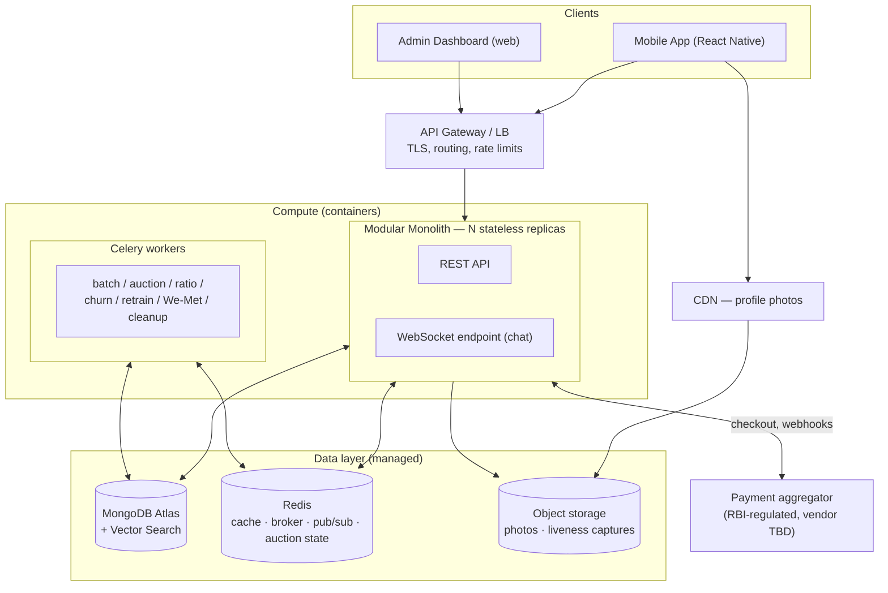
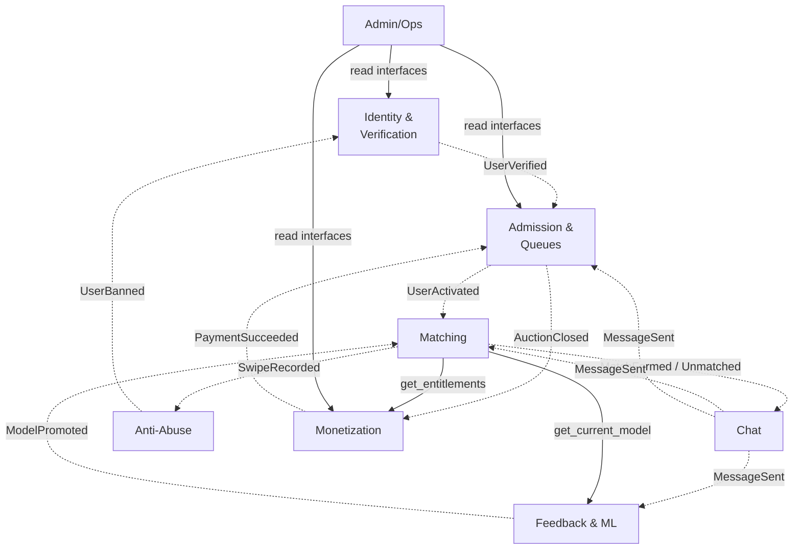
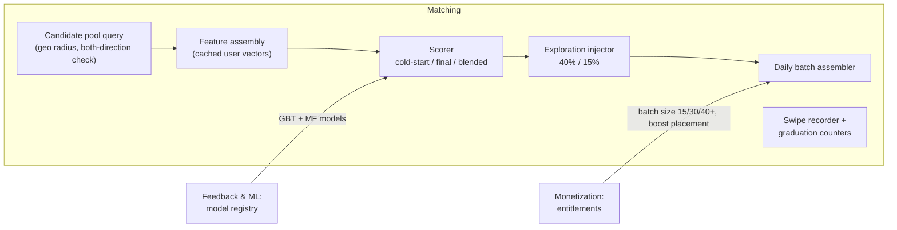
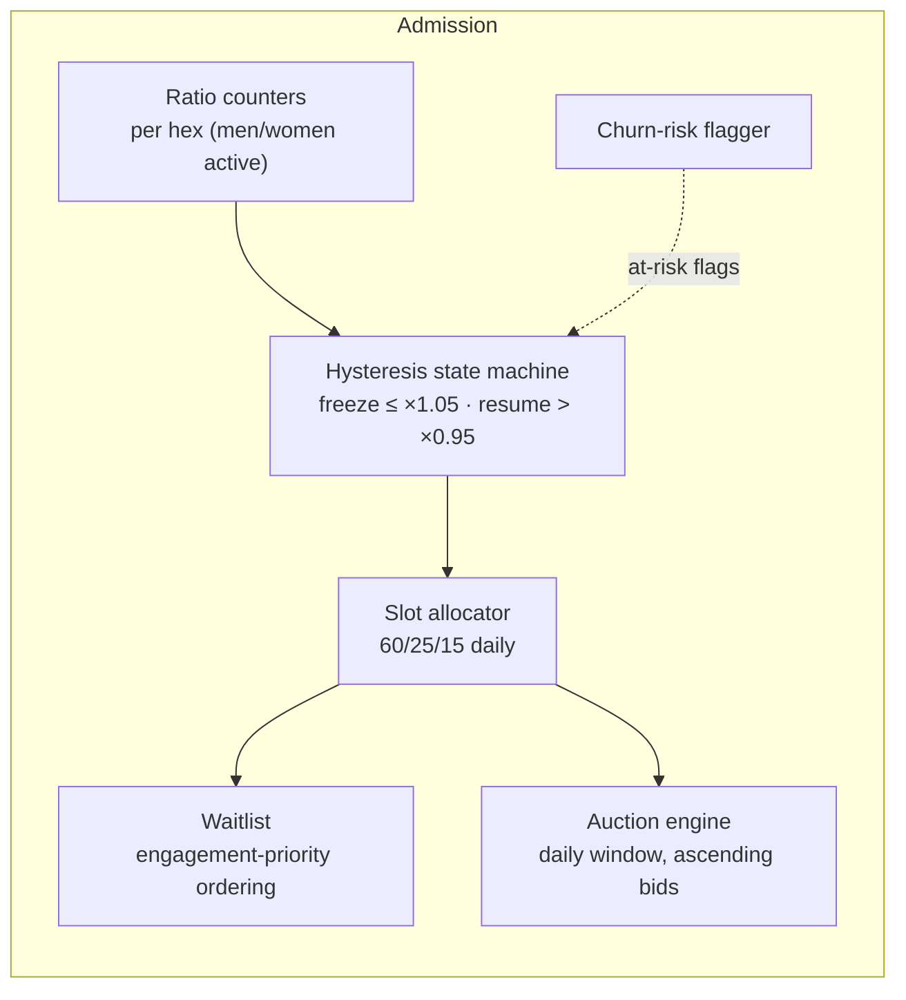
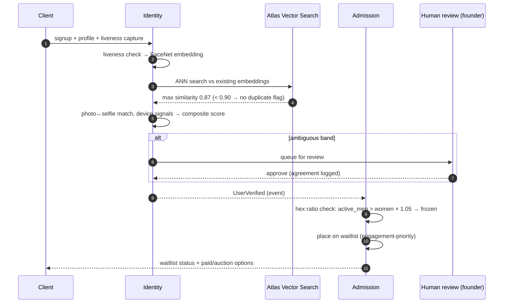
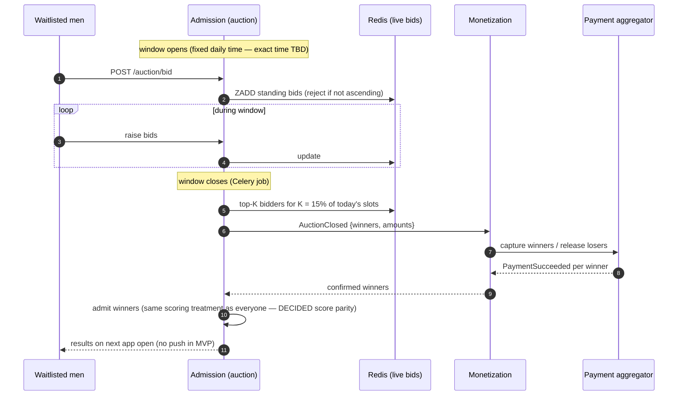
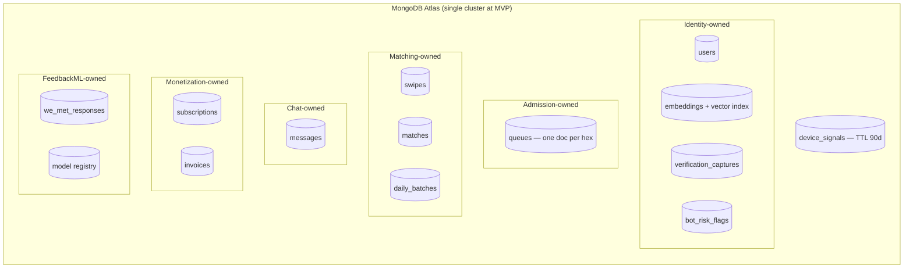
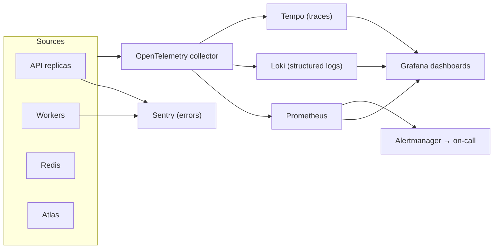

# Sincère — Architecture Plan

> Long-term system design: start as a **modular monolith**, evolve module-by-module into microservices with minimal refactoring. Companion documents: [TECHNICAL_IMPLEMENTATION_PLAN.md](TECHNICAL_IMPLEMENTATION_PLAN.md) (build detail), [README.md](README.md) (product context), [APPLICATION_WORKING.md](APPLICATION_WORKING.md) (plain-English walkthrough).
>
> **Convention:** product/system decisions come from the project decision record and are marked **(DECIDED)** where load-bearing. Infrastructure choices the record is silent on (FastAPI, Celery, Redis, Kubernetes, S3-compatible storage, React Native) are stated *assumptions*, consistent across this documentation suite.

---

## Table of Contents

1. [Architectural Principles](#1-architectural-principles)
2. [High-Level Architecture](#2-high-level-architecture)
3. [Why a Modular Monolith First](#3-why-a-modular-monolith-first)
4. [Module Boundaries](#4-module-boundaries)
5. [Component Diagrams](#5-component-diagrams)
6. [Sequence Diagrams](#6-sequence-diagrams)
7. [Event-Driven Architecture & Async Communication](#7-event-driven-architecture--async-communication)
8. [Current MVP Architecture vs. Future Microservice Architecture](#8-current-mvp-architecture-vs-future-microservice-architecture)
9. [Migration Plan (Monolith → Microservices)](#9-migration-plan-monolith--microservices)
10. [Infrastructure](#10-infrastructure)
11. [Scaling Strategy](#11-scaling-strategy)
12. [Database Architecture](#12-database-architecture)
13. [Monitoring Stack](#13-monitoring-stack)

---

## 1. Architectural Principles

| # | Principle | Consequence |
|---|---|---|
| P1 | **Module = future service.** Every module is designed as if it will be extracted: own data, public interface, event-based reactions | Extraction is a deployment change, not a rewrite |
| P2 | **Data ownership is absolute.** One writer per collection; readers go through the owner's interface | No shared-database coupling to unwind later |
| P3 | **Events for reactions, calls for questions.** Cross-module side effects ride domain events; synchronous lookups use the owning module's interface | Both patterns survive extraction (event bus → broker; interface → RPC/REST) |
| P4 | **The H3 region is the unit of scale.** Ratio state, queues, cold-start maturity, and match batches are all per-hex **(DECIDED)** | New cities add horizontal load; a natural shard key exists from day one |
| P5 | **Config over code for tunables.** Hysteresis band, dwell thresholds, weights, similarity cutoffs are launch defaults flagged for refinement **(DECIDED)** | Tuning never requires a deploy |
| P6 | **Privacy is architectural, not procedural.** Embeddings-only storage, single overwritten location value, bounded deletion — the risky data mostly doesn't exist to protect | Retention jobs are first-class, alerted infrastructure |
| P7 | **Fairness invariants are enforced in code paths, not policy docs.** No score advantage for paid/auction entrants; never evict; boost is labeled **(all DECIDED)** | Tested as invariants ([TECHNICAL_IMPLEMENTATION_PLAN.md §24](TECHNICAL_IMPLEMENTATION_PLAN.md#24-testing-strategy)) |

---

## 2. High-Level Architecture

MVP deployment view:



One deployable, two entrypoints (API server and worker), three managed data services, one external payment dependency. Everything else in this document is about the *internal* structure that keeps this simple deployment from becoming a big ball of mud.

---

## 3. Why a Modular Monolith First

### The decision

Build the MVP as a single deployable containing eight strictly-bounded modules, then extract services **only when a specific pressure demands it**.

### Why not microservices from day one

| Microservices-first cost | Reality for Sincère at MVP |
|---|---|
| Network calls between every domain | Adds latency and failure modes to a product whose hardest problems (ratio control, matching quality) are *domain* problems, not scale problems |
| Distributed transactions / sagas for cross-domain flows | Signup→verification→admission and deletion-cascade flows span many domains; in-process they're straightforward, distributed they're the hardest category of bug |
| Per-service infra: CI/CD, observability, versioned APIs, service discovery | A ~1–3 person launch team pays this tax on every change |
| Independent scaling benefit | Zero benefit at one-city volume — every service would be at minimum replica count anyway |
| Independent team ownership benefit | There is one team; there is nothing to decouple organizationally |
| Wrong boundaries are expensive | Pre-launch, boundaries are informed guesses; real usage will move them. Redrawing a module boundary is a refactor; redrawing a service boundary is a migration project |

The last row is decisive. **The riskiest thing about microservices is committing to boundaries before the domain is understood** — and a pre-launch product understands its domain least. A modular monolith lets boundaries be corrected cheaply for a year, then hardened into network boundaries once real load and real seams are known.

### Why not an unstructured monolith

Because the extraction *will* eventually be needed (chat's connection-scaling profile and embedding inference's compute profile already predict it — see [§9](#9-migration-plan-monolith--microservices)), and an unstructured monolith makes it a rewrite. The discipline costs little now: a directory convention, an import linter, and an event bus abstraction.

### What "modular" concretely means here

1. Eight modules, each mapping to one future service ([§4](#4-module-boundaries)).
2. One writer per MongoDB collection (P2).
3. Cross-module calls only via `module/api.py` public interfaces — enforced by import-linting in CI.
4. Cross-module reactions only via domain events on a bus *interface* whose MVP implementation is in-process and whose future implementation is a broker — consumer code identical.
5. No shared business logic in `shared/` — only cross-cutting plumbing.

---

## 4. Module Boundaries

Eight modules, mirroring the decision record's logical services (§10). Each row is a future-service contract:

| Module | Owns (data) | Public interface (sync) | Emits | Consumes |
|---|---|---|---|---|
| **Identity & Verification** | `users` (identity fields), `embeddings`, `verification_captures`, `bot_risk_flags` | `get_user_status`, `verify_token_scope` | `UserVerified`, `UserRejected` | `UserBanned`, `AccountDeletionRequested` |
| **Admission & Queues** | `queues` (per-hex state, waitlist, auction) | `get_queue_status`, `get_region_health` | `UserActivated`, `AdmissionFrozen/Resumed`, `AuctionClosed` | `UserVerified`, `ActiveStatusChanged`, `PaymentSucceeded`, `MessageSent` (churn features) |
| **Matching** | `swipes`, `matches`, daily-batch store | `get_daily_batch`, `get_matches` | `SwipeRecorded`, `MatchFormed`, `Unmatched` | `UserActivated`, `MessageSent` (engagement) |
| **Chat** | `messages`, per-match engagement aggregates | `get_engagement(match_id)` | `MessageSent`, `HarassmentReported` | `MatchFormed`, `Unmatched` |
| **Anti-Abuse** | warning ledger (on `users.warnings`), dwell aggregates | `get_standing(user_id)` | `WarningIssued`, `UserBanned` | `SwipeRecorded` |
| **Monetization** | `subscriptions`, `invoices`, payment refs | `get_entitlements(user_id)`, `can_view_entry_tier(viewer)` | `PaymentSucceeded`, `SubscriptionChanged` | `AuctionClosed` (charge/refund) |
| **Feedback & ML** | `we_met_responses`, model registry, training sets | `get_current_model(name)` | `ModelPromoted`, `WeMetPromptDue` | `MessageSent`, `MatchFormed`, `Unmatched` |
| **Admin/Ops** | dashboard config, audit views | (UI-facing APIs only) | `ThresholdChanged`, `ReviewDecision` | nearly all events (read-side) |

Boundary judgment calls worth recording:

- **Anti-Abuse is separate from Identity's bot-risk routing (DECIDED).** The decision record is explicit: dwell-time warning/ban is its own graduated track, not a branch of signup-time bot-risk scoring. Two modules keeps that separation structural.
- **Engagement aggregates live in Chat; engagement *scoring* lives in Matching.** Chat owns the raw counts/latencies (it owns messages); Matching owns how they become a 0–1 score. The seam matches data ownership.
- **The activity tracker (30-day login+swipe definition) is shared plumbing** emitting `ActiveStatusChanged`; Admission owns what the ratio does with it.
- **Auth is part of Identity at MVP**, not a ninth module — token issuance is thin; splitting it pre-scale buys nothing. At extraction time, the gateway takes over token *validation* while Identity keeps *issuance* ([§8](#8-current-mvp-architecture-vs-future-microservice-architecture)).
- **"Notification service" exists as an event consumer from day one** even though MVP delivery is only in-app inboxes — push (v2, **DECIDED** deferral) becomes an added delivery adapter, not a new integration ([TECHNICAL_IMPLEMENTATION_PLAN.md §17](TECHNICAL_IMPLEMENTATION_PLAN.md#17-notifications)).

---

## 5. Component Diagrams

### Module dependency graph (sync interfaces, solid; events, dashed)



Note the shape: **events dominate; sync calls are few and read-only.** That is deliberate (P3) — read-only sync calls are the cheapest kind to turn into network calls later.

### Inside the Matching module



### Inside Admission & Queues



---

## 6. Sequence Diagrams

### Signup → verification → admission (man, region at ceiling)



### Daily auction (once-daily fixed window — DECIDED)



### Chat message ripple (the data-flywheel moment)

```mermaid
sequenceDiagram
    autonumber
    participant A as User A
    participant CH as Chat
    participant B as User B (online)
    participant MT as Matching
    participant FM as Feedback & ML
    participant AQ as Admission

    A->>CH: message via WebSocket
    CH->>CH: persist; update msg_count, response latency
    CH->>B: deliver (WebSocket)
    par event fan-out
        CH-->>MT: MessageSent → engagement_score refresh
        CH-->>FM: MessageSent → We-Met check (20–30 msgs / 3 days?)
        CH-->>AQ: MessageSent → churn-feature update
    end
    opt threshold reached
        FM->>FM: schedule We-Met prompt (re-ask 1–2 wks if "not yet")
    end
```

### Account deletion cascade (DECIDED shape)

```mermaid
sequenceDiagram
    autonumber
    participant U as User
    participant ID as Identity
    participant ALL as All modules (event consumers)
    participant J as Retention-cleanup job

    U->>ID: DELETE /me
    ID-->>ALL: AccountDeletionRequested
    ALL->>ALL: immediate — hide profile, remove from pools, queues, batches
    ID->>ID: mark soft-deleted, hard_delete_after = now + 30d
    alt user returns ≤ 30 days
        U->>ID: POST /me/restore
        ID-->>ALL: restore (grace recovery — DECIDED)
    else day 30
        J->>ALL: hard delete profile, photos, captures, embeddings;<br/>chat per 90-day post-unmatch rule
        Note over J: payment records untouched —<br/>financial-regulation retention, decoupled (DECIDED)
    end
```

---

## 7. Event-Driven Architecture & Async Communication

### The bus abstraction

```python
# shared/events.py — the load-bearing indirection
class EventBus(Protocol):
    def publish(self, event: DomainEvent) -> None: ...
    def subscribe(self, event_type: type[DomainEvent], handler: Handler) -> None: ...

# MVP: InProcessEventBus — synchronous-dispatch-to-async-task, at-least-once via outbox
# Later: BrokerEventBus — same interface over RabbitMQ/Redpanda/Kafka
```

Rules that keep MVP events broker-ready:

1. **Events are facts, not commands** — `MessageSent`, never `UpdateEngagementScore`. Consumers decide their own reactions; new consumers attach without touching producers.
2. **At-least-once + idempotent consumers** from day one (an outbox collection makes in-process delivery durable across crashes). This is the semantic a broker will give us anyway; adopting it early means extraction changes nothing behavioral.
3. **Versioned, additive-only payloads.**
4. **No event carries data its consumer shouldn't own** — e.g., `MessageSent` carries counts/latency metadata, never message bodies (privacy posture, P6).

### What's async vs. sync — the decision rule

| Interaction | Mode | Why |
|---|---|---|
| Engagement/churn/We-Met updates from chat | Async event | Eventually-consistent by nature; must not slow message delivery |
| Ratio recompute on activity change | Async event (+ hourly sweep) | Counter drift tolerable for minutes; hysteresis band absorbs noise |
| Entitlement check when assembling a batch | Sync interface | Batch needs the answer now; read-only; cacheable |
| Payment → queue placement | Async event (webhook-driven) | External latency; retries; idempotency keys |
| Duplicate check at signup | Sync within Identity's own pipeline | Single-module concern; user is waiting on a "verifying" screen |
| Ban propagation | Async event | Seconds of lag acceptable; consumers are many |

---

## 8. Current MVP Architecture vs. Future Microservice Architecture

### Current (MVP)

The [§2 diagram](#2-high-level-architecture): one monolith image (API + worker entrypoints), Redis, Atlas, object storage, payment aggregator. Deploy target: a small managed-Kubernetes cluster or even simpler container hosting — the architecture doesn't require k8s until there are multiple services to orchestrate.

### Future (full extraction — end state, reached only under pressure)

```mermaid
flowchart TB
    APP["Mobile App"] --> GW
    ADM2["Admin UI"] --> GW

    GW["API Gateway<br/>routing · authN (JWT validation) · rate limits · WS termination"]

    subgraph SVC["Services (each: own deploy, own data)"]
        AUTH["Auth service<br/>(token issuance — split from Identity)"]
        USR["User service<br/>(profiles, location, radius)"]
        IDV["Identity/Verification service<br/>(liveness, embeddings, bot-risk)<br/>GPU-backed inference"]
        ADQ["Admission/Queue service<br/>(ratio, waitlist, auction)"]
        MTC["Matching service<br/>(pools, scoring, daily batches)"]
        AIS["AI/ML service<br/>(model serving + training pipelines)"]
        CHT["Chat service<br/>(WS fleet, messages)"]
        NTF["Notification service<br/>(in-app inbox + push v2: FCM/APNs)"]
        ANL["Analytics service<br/>(event warehouse, metrics read-side)"]
        ADMS["Admin service"]
        MON["Monetization service"]
    end

    BRK[("Message broker<br/>(RabbitMQ / Kafka-class)")]

    subgraph DATA2["Data (per-service ownership)"]
        M1[("Mongo: users/profiles")]
        M2[("Mongo: queues")]
        M3[("Mongo: swipes/matches")]
        M4[("Mongo: messages")]
        M5[("Mongo + Vector: embeddings")]
        M6[("Mongo: subs/invoices")]
        WH[("Analytics warehouse")]
        RD2[("Redis cluster")]
    end

    GW --> AUTH & USR & ADQ & MTC & CHT & NTF & MON & ADMS
    SVC <--> BRK
    IDV --> M5
    USR --> M1
    ADQ --> M2
    MTC --> M3
    CHT --> M4
    MON --> M6
    ANL --> WH
    MTC --> AIS
    SVC <--> RD2
```



Mapping to the module table in [§4](#4-module-boundaries): each module becomes one service, with three additions that only make sense at scale — **Auth** splits token *validation* into the gateway and *issuance* into a thin service; **User service** splits profile/location CRUD out of Identity (verification and profiles have different change rates and load); **Analytics** becomes a real service once product/growth needs a warehouse rather than dashboard queries (its "module" at MVP is just the Admin read-side + audit log).

### Side-by-side

| Dimension | MVP monolith | Extracted end state |
|---|---|---|
| Deployables | 1 image, 2 entrypoints | ~11 services + gateway |
| Cross-domain reaction | In-process bus (outbox-backed) | Broker (same event contracts) |
| Cross-domain question | Python interface call | REST/gRPC (same signatures) |
| AuthZ | Middleware in-process | Gateway validates; services trust gateway-forwarded claims |
| Data | One Atlas cluster, per-module collections | Same collections, split across clusters per service as needed |
| Scaling unit | Whole app | Per service (chat fleet ≠ batch scorer ≠ GPU inference) |
| Team fit | 1–3 engineers | Multiple teams with independent release trains |

---

## 9. Migration Plan (Monolith → Microservices)

**Extraction is pull, not push:** a service is extracted when a concrete pressure appears, not on a calendar. The strangler-fig recipe for every extraction:

1. Module already has: own collections, public interface, event contracts (guaranteed by CI boundary linting).
2. Stand the module up as a separate deployment of the same codebase (feature-flagged).
3. Swap the in-process interface implementation for an RPC client; swap bus binding to the broker for that module's topics.
4. Dual-run/shadow → cut over → delete the in-monolith copy.

### Expected order and triggers

| Order | Extraction | Trigger (the "pull") |
|---|---|---|
| 0 | **Broker replaces in-process bus** (monolith intact) | First extraction approved — do this once, first; all later extractions reuse it |
| 1 | **Chat** | WebSocket connection count forces scaling the whole monolith for a connection-holding workload; chat's release cadence hostage to batch code (or vice versa) |
| 2 | **Embedding inference (Identity's compute core → AI service seed)** | Signup verification latency/cost demands GPU instances — pointless to attach GPUs to the whole monolith |
| 3 | **Matching batch/scoring** | Nightly batch window vs. API resource contention; multi-city batch parallelism wants an independently sized worker fleet |
| 4 | **Admission/Queues** | Many-region operation; auction traffic spikes isolated from user-facing API |
| 5 | **Monetization** | PCI/audit isolation; payment-vendor changes decoupled from app releases |
| 6 | **Auth split, User service, Notification, Analytics, Admin** | Organizational scale (multiple teams), warehouse needs, push-notification volume (v2+) |

### Non-triggers (explicitly)

- "We have time this quarter" — extraction without pressure adds pure operational cost.
- A single slow endpoint — profile and fix in place first.
- Resume-driven architecture.

### Data-migration notes

Because collections are single-writer from day one, extracting a service's data is *moving collections it already exclusively owns* to its own cluster — a replication/cutover exercise, not a schema disentanglement. The painful classic ("who else writes this table?") is designed out.

---

## 10. Infrastructure

| Concern | MVP | Scale-up |
|---|---|---|
| **Compute** | Managed Kubernetes (small node pool) *or* simpler container hosting; k8s recommended from start only because the team gets one deployment grammar for the whole journey *(assumed)* | Same cluster grammar; per-service Deployments/HPAs; GPU node pool for the AI service |
| **Kubernetes shape** | `api` Deployment (HPA on CPU/RPS), `worker` Deployment, `beat` (1 replica, leader-elected), Ingress + cert-manager | Per-service namespaces; PodDisruptionBudgets; broker via operator or managed service |
| **MongoDB** | Atlas M-tier replica set + Vector Search, single region (India — e.g., Mumbai) | Shard `users` by `h3_region`-aligned key, `messages` by `match_id`; per-service clusters as services extract; Qdrant only if Atlas vector search genuinely bottlenecks **(DECIDED trigger)** |
| **Redis** | One managed instance: cache, Celery broker, pub/sub (WS fan-out), auction live state, rate limits | Split by role (cache vs. broker vs. pub/sub); Redis Cluster; auction state gets persistence (AOF) or moves to broker-backed streams |
| **CDN** | Profile photos only (signed URLs, private bucket origin) | Add static/app-shell assets; regional edge as cities multiply |
| **Object storage** | S3-compatible, private; prefixes `photos/` (account-lifetime) and `captures/` (30-day lifecycle rule mirroring the retention decision) | Lifecycle policies per retention class; replication if multi-region |
| **Message queues** | Redis-backed Celery for jobs; in-process outbox-backed event bus | Broker (RabbitMQ or Kafka-class) for domain events at first extraction; Celery stays for scheduled batch work |
| **Secrets/config** | Platform secret store; tunable thresholds via audited admin config (P5) | Vault-class store; per-service scoping |
| **IaC** | Terraform for Atlas/Redis/CDN/DNS/k8s *(assumed)* | Same, modularized per environment/service |

---

## 11. Scaling Strategy

### The load model

Sincère's traffic is unusually *shaped* for a dating app, and the architecture exploits it:

| Load source | Shape | Lever |
|---|---|---|
| Daily-15 fetch + swipe burst | Sharp daily peak (worse if all-at-once delivery is chosen) | Precomputed batches; horizontal API replicas; the open all-at-once-vs-trickle decision is partly a *load-shaping* decision |
| Chat | Long-lived connections, low per-connection throughput | Redis pub/sub fan-out now; dedicated WS fleet at extraction #1 |
| Nightly scoring batch | Offline, embarrassingly parallel per region (P4) | Worker fleet sizing; per-region task fan-out |
| Auction window | Once-daily spike per region | Redis sorted-set bidding; windows could be staggered per region if needed |
| Signup verification | Bursty (marketing-driven); compute-heavy | Async pipeline with "verifying" UX; GPU extraction #2 |
| Waitlist ceiling **(DECIDED product mechanic)** | Male signups queue rather than hammer matching | The product itself throttles the biggest load class — an underrated architectural gift |

### Growth playbook

1. **Vertical + replicas** (Atlas tier, API replica count) — covers single-city launch entirely.
2. **Per-region parallelism** — new cities are new hexes; batch, queue, and ratio work scale linearly and independently (P4).
3. **Read scaling** — Redis cache hit-rate first, Mongo secondary reads second.
4. **Extractions** — per [§9](#9-migration-plan-monolith--microservices) triggers only.
5. **Sharding** — `h3_region`-aligned for user-ish data, `match_id` for messages; the shard keys exist in the schema from day one.

---

## 12. Database Architecture

Full collection schemas: [TECHNICAL_IMPLEMENTATION_PLAN.md §8](TECHNICAL_IMPLEMENTATION_PLAN.md#8-database-schema).



Design points:

- **Ownership boundaries drawn inside one cluster** — the split-to-per-service-clusters move later is mechanical (P2, [§9](#9-migration-plan-monolith--microservices)).
- **Geo:** 2dsphere on `users.last_recorded_location` powers the radius query; `h3_region` is a plain indexed string (H3 assignment is computed in app code — cheap and deterministic).
- **Vector:** Atlas Vector Search index on `embeddings.vector`, cosine — duplicate checks and visual-pattern lookups, no second system **(DECIDED)**.
- **Retention enforced at the schema layer where possible** (TTL for device signals), by alerted jobs where semantics are conditional (grace-period cascade, investigation holds on messages).
- **Consistency stance:** money and admission decisions use strong single-document semantics (Mongo transactions where a decision spans waitlist + counters); engagement scores, churn features, and analytics are eventually consistent by design.

---

## 13. Monitoring Stack

*(assumed tooling; metric definitions in [TECHNICAL_IMPLEMENTATION_PLAN.md §21](TECHNICAL_IMPLEMENTATION_PLAN.md#21-monitoring))*



The dashboards that matter most are **product-invariant dashboards**, not CPU graphs: per-hex ratio health and hysteresis state, waitlist depth/wait time per tier, batch completion vs. delivery deadline, auction settlement success, churn-risk flag trends (women especially), review-queue depth vs. founder capacity, and retention-cleanup job success (a failed deletion job is a compliance incident — always pages).

---

*Cross-references: build detail — [TECHNICAL_IMPLEMENTATION_PLAN.md](TECHNICAL_IMPLEMENTATION_PLAN.md) · product overview — [README.md](README.md) · plain-English system walkthrough — [APPLICATION_WORKING.md](APPLICATION_WORKING.md)*
