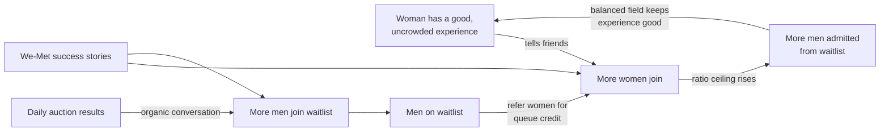

# Sincère — Marketing Plan

> Go-to-market strategy for an equal-playing-field dating app launching in India. Product detail: [README.md](README.md); how the system actually works (useful for anyone writing copy about it): [APPLICATION_WORKING.md](APPLICATION_WORKING.md).
>
> **Grounding note:** product mechanics cited here (1:1 ratio, three-tier queues, 15/day, Pro tiers, We-Met, no push notifications in MVP) come from the project decision record. Market-size figures are directional estimates built on the one benchmark in the record — *dating-app active users ≈ 3–4% of India's smartphone base, concentrated in the 18–35 band and major metros* — plus clearly-marked public-order-of-magnitude assumptions. All pricing is illustrative: exact prices are an open decision (decision record §11.2).

---

## Table of Contents

1. [Product Positioning](#1-product-positioning)
2. [Ideal Customer Profiles & Audiences](#2-ideal-customer-profiles--audiences)
3. [User Personas](#3-user-personas)
4. [Market Size — TAM / SAM / SOM](#4-market-size--tam--sam--som)
5. [Competitive Landscape](#5-competitive-landscape)
6. [Go-to-Market Strategy](#6-go-to-market-strategy)
7. [Launch Strategy](#7-launch-strategy)
8. [Growth Channels](#8-growth-channels)
9. [Community, Content & Partnerships](#9-community-content--partnerships)
10. [Retention, Engagement & Virality](#10-retention-engagement--virality)
11. [KPIs](#11-kpis)
12. [Revenue Strategy & Pricing](#12-revenue-strategy--pricing)
13. [Growth Roadmap](#13-growth-roadmap)

---

## 1. Product Positioning

### The one-liner

> **Sincère: the dating app where the odds are actually fair.** One man for every woman — enforced, not promised.

### Positioning statement

For serious daters in Indian metros who are exhausted by apps where women drown in low-effort attention and men shout into the void, Sincère is a dating app that **enforces a 1:1 active gender ratio** in every local area, delivering **15 curated matches a day** instead of an infinite swipe feed. Unlike Tinder, Bumble, or Hinge — which monetize the imbalance — Sincère's business model *depends on keeping the field level*: paying moves you up the entry queue but **never buys a better match score**.

### Positioning pillars (each maps to a real, decided mechanic)

| Pillar | Message | Mechanic behind it |
|---|---|---|
| **Fairness** | "One-to-one, enforced per city area — not a marketing claim" | Per-hex ratio ceiling, hysteresis control, waitlist |
| **Intentionality** | "15 real options a day, not 500 maybes" | Curated daily batch, hybrid matching |
| **Honest monetization** | "Money buys the front of the line, never a better match" | Score parity for paid/auction entrants (explicitly decided) |
| **Scarcity as quality** | "Getting in means something" | Male waitlist + daily auction — admission is an event |
| **Privacy-respecting** | "We check your location when you open the app. That's it." | `last_recorded_location` only; no background tracking; no beauty scores; embeddings-only face data |
| **Real outcomes** | "We optimize for dates that happen, not swipes that don't" | "We Met" feedback loop retraining the matching models on real-world meetings |

### What we deliberately do NOT say

- Never "exclusive/elite" framing — the waitlist is a *fairness* mechanism, not a status filter; elite positioning would poison the free queue and invite the "paid = better people" misread we already flagged as a risk (entry-tier visibility, decision record §6).
- No appearance-based claims of any kind — the product explicitly rejected attractiveness scoring; marketing must never reintroduce it rhetorically.
- No "guaranteed matches/dates" — the promise is fair *odds*, not outcomes.

---

## 2. Ideal Customer Profiles & Audiences

### Primary audience — the supply side we must win: urban Indian women, 22–32

The entire product thesis lives or dies on women's experience (the ratio ceiling is *their* count). They are the primary audience for acquisition, messaging, and retention investment — the product is literally architected around retaining them (churn-prediction flags at-risk women proactively).

| Attribute | Profile |
|---|---|
| Age / location | 22–32, metro India (launch city first) |
| Current behavior | Has tried Tinder/Bumble/Hinge; churned or semi-active out of fatigue (harassment, low-intent matches, volume overload) |
| Pain | "It's not that there are no men; it's that it's a firehose of nothing" |
| Hook | 15/day curation + a male population that cleared liveness verification and a waitlist to be there |
| Sensitivities | Safety and privacy above all — verification, no location trails, no beauty scoring are first-class selling points |

### Secondary audience — the demand side that funds it: urban Indian men, 24–35

| Attribute | Profile |
|---|---|
| Age / location | 24–35, metro India, smartphone-native, has disposable income (some willing to pay for the paid queue/auction/Pro) |
| Current behavior | Active on 2–3 apps with near-zero result; already paying for boosts that don't work |
| Pain | "I get no matches, and paying just buys me more of nothing" |
| Hook | A 1:1 field where attention is mathematically possible; a waitlist that is *honest* about why it exists; paid/auction lanes with a transparent promise (earlier entry, same odds inside) |
| Willingness to pay | High — this is the monetization base (paid queue 25%, auction 15% of admission slots, Pro subscriptions) |

### Tertiary

- **Returners to dating after long relationships (30–40):** value curation over volume; strong fit, lighter marketing priority.
- **Explicitly NOT targeted at launch:** non-metro/rural (H3 covers them, but cold-start needs metro density first); users seeking casual-only high-volume swiping (the product shape is deliberately hostile to it — see dwell-time anti-spam).

---

## 3. User Personas

### Persona 1 — "Priya," 27, Product Designer, launch city

- Deleted Bumble twice. 400+ likes pending, 3 conversations worth having, 1 date in six months.
- **What wins her:** "15 verified men a day, every one of whom waited for a spot" + visible safety architecture (liveness-verified profiles, harassment-report handling with chat-retention holds).
- **What loses her:** any hint of the firehose returning; creepy location behavior; feeling like the product monetizes male desperation at her expense.
- **Journey:** installs from a friend's recommendation → verified in minutes → daily-15 becomes a coffee-break ritual → responds because conversations start from actual profile content → tells two friends. *Priya's referral is the single most valuable growth event in the company.*

### Persona 2 — "Arjun," 29, Software Engineer, launch city

- Three years on three apps. Right-swipes broadly (which the dwell-time system will teach him to stop doing), matches rarely.
- **What wins him:** the math, stated plainly — "here, the ratio is 1:1, enforced." He joins the waitlist, watches his position, and on week two pays the fixed paid-queue price (or bids in Thursday's auction) because *for once the thing being sold is real*.
- **What loses him:** opaque waitlist movement; feeling scammed by the auction; discovering paid users get hidden advantages (they don't — score parity is decided — and marketing must keep saying so).
- **Post-admission:** 15 curated profiles where his likes land in a balanced field; graduates the cold-start phase (20 swipes, 3 matches) into personalized ranking.

### Persona 3 — "Meera," 31, returning after a 6-year relationship

- Finds infinite-swipe apps alien and gross. Wants intentional, wants safe, will pay for control.
- **What wins her:** curation, verification, and Pro-tier controls (advanced filters; "see who liked you" in Pro Plus; entry-tier visibility — she'd like to know if a man paid or waited).
- **Note:** Meera is the natural buyer of the women-side Pro subscription — the record's decision to open Pro to both genders is largely a Meera decision.

### Persona 4 — "Rohit," 33, marketing manager, high willingness-to-pay

- Time-poor, results-oriented. The auction is *for* him: a predictable, marketable daily event (decided: once daily, fixed window) where he can simply buy today's front-of-line.
- **Risk to manage:** Rohit must never be sold "better matches" — only earlier entry. Compliance between marketing copy and the score-parity mechanic is a brand-integrity issue, not a nicety.

---

## 4. Market Size — TAM / SAM / SOM

**Method transparency:** the only benchmark from the decision record is *dating-app active users ≈ 3–4% of India's smartphone base, 18–35-concentrated, metro-concentrated*. Smartphone-base and metro-population figures below are public-order-of-magnitude assumptions (India smartphone users ≈ 650–700M, 2026); treat outputs as directional, to be replaced with the soft-launch's measured adoption data — exactly as the record prescribes for H3 calibration.

| Tier | Definition | Estimate | Basis |
|---|---|---|---|
| **TAM** | India dating-app active users | **~20–28M** | 3–4% × ~650–700M smartphone base (record's benchmark) |
| **SAM** | Active users in the top ~8–10 metros, 18–35, reachable by a metro-first launch | **~8–12M** | Metro + age concentration per the same benchmark; metros are where density supports the ratio system's cold start |
| **SOM (24 mo)** | Realistic capture across the first 3–5 launch cities | **~150–400K MAU** | 2–4% share of SAM in launched cities; deliberately conservative — the ratio ceiling means *male* MAU is capped by female MAU, so SOM is effectively **2× the women we can win** |

**The strategic reframe SOM forces:** Sincère's growth constraint is not demand (men queue by design) but **female active-user acquisition and retention**. Every growth plan line item below is weighted by its effect on women's sign-up and 30-day retention. The male waitlist converts male demand from a load problem into a *marketing asset* (visible scarcity) — but only women's numbers raise the ceiling.

Revenue sizing follows the same logic: monetizable events (paid queue, auction, Pro) scale with admission slots, which scale with active women. See [§12](#12-revenue-strategy--pricing).

---

## 5. Competitive Landscape

| Competitor | Model | Their gender-imbalance answer | Sincère's wedge |
|---|---|---|---|
| **Tinder** | Infinite swipe, volume monetization | None — monetizes the imbalance (boosts, super likes) | We remove the imbalance instead of selling painkillers for it |
| **Bumble** | Women-message-first | UX-level patch; ratio untouched | Their fix changes who speaks first; ours changes who's in the room |
| **Hinge** | "Designed to be deleted," prompts, We-Met | Best-in-class intent signal; ratio untouched | We adopt their best idea (We-Met feedback loop — credited openly) *and* fix the ratio they don't |
| **Aisle / TrulyMadly / Indian players** | Intent-heavy, verification-forward, India-first | Verification gates quality; ratio untouched | Same India-first trust posture, plus the structural fix |
| **Matrimony platforms (Shaadi, BharatMatrimony)** | Family-mediated, marriage-explicit | Different market; sets Indian users' expectations for "serious = verified" | We occupy the space between hookup apps and matrimony — self-driven but intentional |
| **Raya/League-style gated apps** | Exclusivity waitlists | Waitlist as *status* | Our waitlist is *arithmetic*, not curation of "eliteness" — and our messaging must keep that distinction sharp |

**Defensibility:** the mechanic is copyable on paper, but incumbents structurally can't copy it — enforcing 1:1 means turning away the majority of their paying users (men) and cannibalizing boost revenue built on scarcity. A ratio guarantee is a *challenger-only* weapon. Secondary moats: per-region cold-start playbook (hard-won operational knowledge), We-Met-labeled training data (real-world outcome labels are rare), and the trust brand with women.

---

## 6. Go-to-Market Strategy

### Strategy in one sentence

**Win women in one city, let the male waitlist grow itself, and let the ratio math force geographic focus discipline.**

The product architecture *is* the GTM architecture: because ratio and cold start are per-hex, a diffuse national launch would create hundreds of dead, sub-critical-mass regions. One city, saturated, is the only launch shape the system rewards. (City selection and sequencing is an open decision — record §5/§11 — but "one city deep first" is strongly implied by the cold-start design and assumed here.)

### Phases

| Phase | Focus | Success gate |
|---|---|---|
| **Pre-launch (8–12 wks)** | Waitlist landing page (city-scoped); women's early-access program; seed community; campus/workplace ambassadors; PR angle: "the app that caps men" | ≥ X women pre-registered in launch city (X set by hex-stability floor from the calibration method in the record) |
| **Soft launch** | Women admitted immediately; men admitted up the buffer (90–95% of active women); founder-led concierge onboarding quality (decided: automated gates + founder review) | Ratio stable without manual intervention; women's W4 retention above threshold |
| **Public city launch** | Open the three-tier queue publicly; first daily auctions as marketable events; PR + influencer push | Sustained women's growth ≥ men's admission absorption |
| **City 2+** | Repeat playbook per city; each city is a fresh cold start by design | City-1 economics validated |

---

## 7. Launch Strategy

### The launch asset: scarcity that is *true*

Most apps fake urgency. Sincère's is structural: men genuinely cannot all get in today. Launch communications lean into it honestly:

- **Public ratio dashboard (city-level):** "Bengaluru today: 1.00 men per woman active. Waitlist: 2,340." Radical transparency as brand.
- **The daily auction as event marketing (mechanic is decided: once daily, fixed window):** a predictable, discussable moment — "what did entry go for today?" is organic content that writes itself.
- **Women skip the line, period:** every piece of women-facing creative carries this.

### Launch-week choreography (illustrative)

1. **D-30 → D-1:** women's early access rolls; seeded profiles reach hex-stability counts; ambassadors active in colleges/workplaces/communities.
2. **D-Day:** public launch = *opening the men's queue*, framed as such. PR: fairness-mechanic explainer coverage (tech + lifestyle press love a mechanism story).
3. **D+7:** first auction results as a story beat; first "15 a day, that's it" creator content.
4. **D+30:** first retention cohort read; hysteresis behavior review; calibration begins (per rollout Phase 3, [TECHNICAL_IMPLEMENTATION_PLAN.md §25](TECHNICAL_IMPLEMENTATION_PLAN.md#25-rollout-plan)).

### Launch constraint to design around (MVP reality)

**No push notifications in MVP (decided).** The daily-15 must be a *pull habit*: marketing and product copy establish a time-of-day ritual ("your 15 drop at 8 PM" — pending the open all-at-once-vs-trickle decision, which marketing should weigh in on: a fixed drop time is far more marketable than a trickle).

---

## 8. Growth Channels

### Organic growth

| Motion | Detail |
|---|---|
| Word-of-mouth (women→women) | The core loop; NPS among women is the growth engine. Product moments engineered to be tellable: "I get 15, they wait in line" |
| The waitlist itself | Men on the waitlist are an *audience we own* — waitlist-position updates, queue stats, auction results keep them engaged pre-admission at zero CAC |
| Public ratio transparency | City dashboards are shareable proof, screenshot-friendly |
| PR / earned media | The mechanic is a story: fairness-by-design, anti-infinite-swipe, "the app that tells men to wait." Founder narrative supports it |

### Paid acquisition

| Channel | Target | Note |
|---|---|---|
| Instagram/YouTube (women 22–32, launch city geo-fenced) | Women first — every rupee of paid raises the admission ceiling | Creative: fatigue-relief + safety; never scarcity-bragging |
| Performance for men | Minimal at launch — the waitlist fills organically; paid male acquisition only if a region's queue thins | The ratio makes male CAC nearly irrelevant early |
| Geo discipline | Ads only where hexes are live | Spending outside live regions manufactures disappointed users |

### SEO

- City-level landing pages ("dating in Bengaluru") anchored on the ratio dashboard data — unique, data-backed pages competitors can't mirror.
- Editorial hub: dating-fatigue, safety, intentional-dating content targeting women's search intent; mechanism explainers ("how the 1:1 ratio works") targeting high-intent research queries.

### ASO

- Keywords: serious dating India, verified dating, curated matches; creative highlights: "15/day," "1:1 enforced," verification badge imagery.
- Ratings strategy: prompt after positive moments only (post-match, post-good-conversation) — never during waitlist frustration.

### Referral strategy

- **Women referring women:** priority perks that don't touch match integrity (early feature access, Pro trial days). *Never* pay-per-signup cash — attracts exactly the fake/low-intent profiles the bot pipeline exists to stop.
- **Men referring women who activate:** waitlist-position credit — turns the male queue into a distributed women's-acquisition sales force. (Bot pipeline's signup-velocity-per-referral-source signal — already in the decided design — polices abuse of this.)
- **Men referring men:** no reward (queue-lengthening is anti-value); allowed organically.

### Influencer strategy

- Micro-influencers (10–100K) in launch city > national macro: city-scoped reach matches hex-scoped supply.
- Women lifestyle/comedy creators: "my 15 today" content format — native, repeatable, honest.
- Men's creators: waitlist/auction experience content ("I bid for a dating app spot and here's why that's actually fair") — self-aware, mechanism-forward.
- Hard rule: creators disclose; no fake success stories; no appearance-ranking content ever (brand-safety mirror of the product's anti-beauty-score stance).

---

## 9. Community, Content & Partnerships

### Community building

- **City community (launch city first):** offline mixers and events where the app's matches can actually meet — directly feeds the We-Met loop's real-world-outcome data once it rolls out, and produces success stories.
- **Women's advisory circle:** early power users with a direct feedback channel; they shape safety features and become authentic advocates.
- **Waitlist community for men:** queue-status content, auction culture, honest expectation-setting — converts waiting from resentment into anticipation.

### Content strategy

| Pillar | Audience | Formats |
|---|---|---|
| Fairness mechanics, explained | Both, press, curious | Explainers, founder posts, ratio-dashboard data stories |
| Dating fatigue & intentionality | Women | Essays, creator collabs, short video |
| Safety & privacy engineering | Women | "How verification works," "what we don't collect" (no location trails, no beauty scores — true differentiators) |
| Success stories (post-We-Met) | Both | Only real, consented couples; the We-Met mechanism gives us verified ones |
| Auction/queue culture | Men | Daily auction recaps, waitlist diaries |

### Partnerships

- Launch-city cafés/venues: "first date" partner venues (discount hooks; co-marketing; physical-world brand presence).
- Colleges/young-professional communities & HR/employee-resource groups: women's early-access programs.
- Safety orgs: credibility partnerships aligned with the harassment-handling design (report → retention hold → investigation).
- *Not* pursuing: telco bundles, data-sharing partnerships (privacy posture forbids), matrimony-platform cross-promo (positioning conflict).

---

## 10. Retention, Engagement & Virality

### Retention (the product's own machinery, marketed)

The retention system is unusually product-native — marketing's job is amplification, not invention:

| Mechanic (decided, in-product) | Marketing/CRM amplification |
|---|---|
| Churn-risk flagging of at-risk women (declining sessions/messages, rising response latency) | Win-back journeys triggered by the same flags: fresh-batch highlights, safety-feature reminders, "here's what changed" (email/SMS-appropriate given no push in MVP) |
| Freshness boost for new users | "Your first weeks are your most visible" onboarding education |
| Engagement-quality-weighted waitlist priority | Tells men: genuine engagement literally moves you up — anti-spam as incentive design |
| 15/day rhythm | The daily ritual is the retention spine; all CRM reinforces the drop-time habit |
| We-Met loop (post-MVP) | Success-story engine + "this app measures real dates, not swipes" proof point |

### Engagement

- North-star engagement event: **conversations with ≥20–30 messages in 3 days** (the We-Met trigger threshold — the product already defines what a "real conversation" is; marketing adopts the same definition, keeping terminology consistent).
- Anti-metric: raw swipe volume. The dwell-time system punishes it; marketing must never celebrate it.

### Virality loops

The primary loop is women→women word-of-mouth; every other loop feeds it or feeds off it. Note the male-side loop *cannot* overrun the system — excess demand pools in the waitlist (a growth asset, not a UX cost).

---

## 11. KPIs

### North star

**Weekly active women per live hex region** — the single number that raises every ceiling (admission, revenue, growth).

### KPI tree

| Layer | KPI | Why it matters |
|---|---|---|
| Supply health | Active women per hex; women's W1/W4/D90 retention; churn-risk-flag rate & win-back conversion | The ratio ceiling *is* this number |
| Ratio integrity | % of regions in-band (0.95–1.05); freeze frequency/duration; waitlist median wait (free tier) | The product promise, measured |
| Match quality | Match rate per daily 15; conversations reaching We-Met threshold (20–30 msgs/3 days); We-Met "yes" rate (post-rollout) | Real-outcome funnel |
| Acquisition | Women's CAC by channel; referral share of women's signups; waitlist net adds (men) | Spend discipline; loop health |
| Monetization | Paid-queue conversion; auction participation rate & avg clearing price; Pro attach rate by gender & tier; ARPPU | See §12 |
| Trust & safety | Verification pass rate; review-queue depth vs. capacity; harassment reports per 1K conversations; ban rate | Brand-critical; also ops-capacity trigger (vendor transition) |
| Sentiment | NPS (women, segmented); entry-tier-visibility reception tracking | The record explicitly requires a reception-monitoring plan for entry-tier visibility — this is it |

---

## 12. Revenue Strategy & Pricing

### Revenue architecture (all mechanics decided; all prices open — record §11.2)

| Stream | Mechanic | Buyer | Price status |
|---|---|---|---|
| **Paid queue** | Fixed price (no surge — decided), 25% of daily admission slots | Waitlisted men | **Open** — set at launch |
| **Auction** | Once-daily ascending-bid window, 15% of slots | High-WTP waitlisted men | Market-priced by design (the auction discovers it) |
| **Basic Pro** | Subscription: higher daily limit (~30), undo swipe, advanced filters (illustrative split) | Both genders | **Open** |
| **Pro Plus** | Basic Pro + "see who liked you," highest limit (40+), labeled boosted visibility (illustrative) | Both genders | **Open** |
| **Entry-tier visibility** | Pro-gated (women): see how a man entered (free/paid/auction) | Pro women | Folded into Pro; **which tier is open** |

### Pricing principles (from the product's own constitution)

1. **Never sell match quality.** Score parity is decided; every price is for *access, speed, or information* — not for better matches. This is both ethics and the brand moat.
2. **Free tier is sacred:** 15/day free forever, never revoked (the eviction-subscription model was explicitly rejected).
3. **The auction is the pricing lab:** clearing prices are live willingness-to-pay data for calibrating the fixed paid-queue price (fixed price should sit meaningfully below typical auction clears — paying for certainty vs. bidding for speed).
4. **Illustrative anchors for planning only** (India-market subscription norms): Basic Pro ₹299–499/mo, Pro Plus ₹599–999/mo, paid queue ₹199–499 one-time. **To be set by the pricing decision, informed by soft-launch auction data.**
5. **Watch the fairness optics:** entry-tier visibility carries a flagged risk (money-signal stigmatizing free-queue men). The KPI tree carries its reception explicitly; be ready to reposition or re-gate it.

### Revenue model shape

Revenue scales with **admission slots × monetization rate + active base × Pro attach** — and admission slots scale with active women. Therefore: *marketing spend on women's acquisition is simultaneously revenue capacity expansion.* This is unusual and worth repeating to investors: the growth spend and the revenue engine point at the same number.

---

## 13. Growth Roadmap

| Horizon | Growth focus | Depends on (product/ops) |
|---|---|---|
| **0–3 mo (soft launch, city 1)** | Women's early access; ambassador program; founder-led community; zero paid spend on men | Concierge onboarding capacity (founder review bandwidth); hex calibration against real 30-day-active data |
| **3–6 mo (public city 1)** | Public launch choreography; auction-as-event marketing; women-targeted paid begins; referral program live | Pricing decisions finalized; payment aggregator integrated; ratio stability demonstrated |
| **6–12 mo (cities 2–3)** | Playbook replication; city-level SEO/dashboards; micro-influencer network per city; PR: city-expansion beats + first We-Met success stories | We-Met rollout (needs conversation volume); city sequencing decision; moderation capacity (possible vendor transition trigger) |
| **12–24 mo (scale)** | 5+ cities; brand campaign (fairness category leadership); retention/win-back sophistication (with push notifications once v2 ships); success-story engine at volume | Push notifications (v2 — transforms CRM); advanced engagement features (v2); infra scale-out per [ARCHITECTURE_PLAN.md §11](ARCHITECTURE_PLAN.md#11-scaling-strategy) |
| **24 mo+** | Category export: additional countries — noting the record's flag that multi-state tax/payment questions reopen for federal-tax countries (e.g., the US) | Jurisdiction-specific legal review (biometric consent per market); payments/tax rework where state-varying |

### The three growth risks we're honest about

1. **Cold-start chicken-and-egg (city 1):** if women's pre-registration misses the hex-stability floor, launch slips — by design. Mitigation: the entire pre-launch phase exists for this; do not launch thin.
2. **Waitlist resentment (men):** waiting must feel fair, transparent, and finite. Mitigation: position visibility, honest ETAs, engagement-priority education, the paid/auction escape valves — and never letting "exclusive" creep into copy.
3. **Entry-tier visibility backlash:** flagged in the record itself. Mitigation: reception KPI from day one, pre-drafted rollback/repositioning plan.

---

*Cross-references: product mechanics — [README.md](README.md) · system detail behind every claim here — [TECHNICAL_IMPLEMENTATION_PLAN.md](TECHNICAL_IMPLEMENTATION_PLAN.md) · plain-English explainer (useful for copywriters and PR) — [APPLICATION_WORKING.md](APPLICATION_WORKING.md)*
