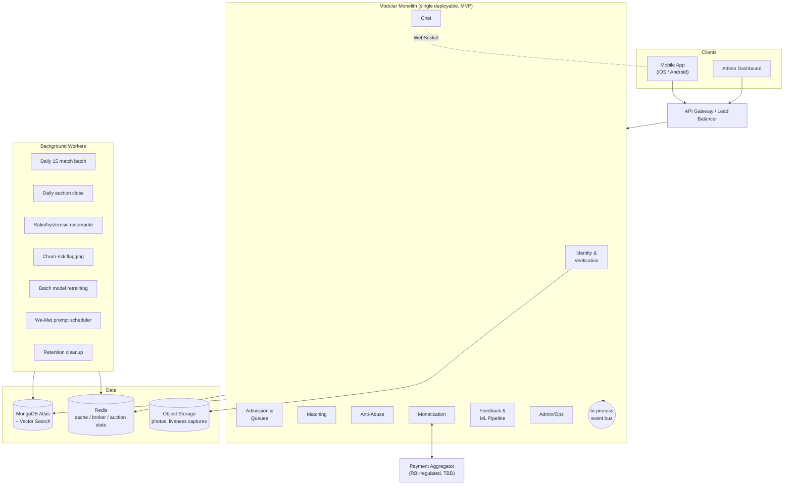

# Sincère

> An equal-playing-field dating app with an enforced 1:1 active gender ratio.

**Documentation suite:**

| Document | Audience | Contents |
|---|---|---|
| [README.md](README.md) (this file) | Everyone | Product, stack, setup, high-level architecture |
| [TECHNICAL_IMPLEMENTATION_PLAN.md](TECHNICAL_IMPLEMENTATION_PLAN.md) | Engineers | Requirements, APIs, schema, ML, formulas, ops |
| [ARCHITECTURE_PLAN.md](ARCHITECTURE_PLAN.md) | Engineers / Architects | Modular monolith → microservices evolution |
| [MARKETING_PLAN.md](MARKETING_PLAN.md) | Business / Growth | Positioning, GTM, personas, KPIs, revenue |
| [APPLICATION_WORKING.md](APPLICATION_WORKING.md) | Everyone (plain-English) | End-to-end explanation of how the app works |

---

## 1. Executive Summary

Dating apps suffer a well-known structural failure: their user base skews roughly **70% men / 30% women**, which degrades the experience for everyone — women get overwhelmed, men get ignored, and both churn. Sincère attacks this at the root instead of papering over it with algorithmic tricks.

**The core differentiator: an enforced 1:1 *active* gender ratio.** Men are admitted through a waitlist that only opens when the active women count in their geographic region supports it. The ratio is measured on *active users* (logged in within 30 days **and** performed at least one swipe/like), not cumulative signups, and is balanced independently per region using Uber's **H3 hexagonal spatial index** (resolution 6, ~36 km² per hex) so a healthy national average can never mask a badly skewed city.

Monetization is built directly into the admission mechanic: daily admission slots per region split **60% free queue / 25% fixed-price paid queue / 15% daily live auction** — all drawing from the *same* ratio-based ceiling, so paying buys *priority*, never extra capacity that would break the 1:1 promise. On top of that sits a two-tier freemium **Pro subscription** (Basic Pro / Pro Plus) available to both genders.

The matching experience is a curated **15 matches per day** driven by a hybrid scoring engine: heuristic scoring for new users, transitioning smoothly to learned models (gradient-boosted-tree reciprocity prediction + matrix-factorization collaborative filtering) as behavioral data accumulates, recalibrated against real-world outcomes via a Hinge-style **"We Met"** feedback loop.

Launch market: **India** (single-city soft launch first), chosen with the regulatory groundwork already validated — GST is nationally uniform and payment aggregators are centrally RBI-regulated, so H3 regions spanning state lines create no tax/licensing conflict.

---

## 2. Product Overview

### The problem

| Failure mode of existing apps | Consequence |
|---|---|
| Signup-based admission with no ratio control | Permanent ~70/30 gender skew |
| Women overwhelmed with low-quality attention | Women churn → skew worsens (death spiral) |
| Men see near-zero results | Men churn or pay for boosts that don't fix the underlying scarcity |
| Global averages hide local skew | A "balanced" platform can still be badly skewed in a specific city |
| Swipe-count monetization | Platform incentivized to keep users swiping, not matching |

### Sincère's answer

1. **Ratio enforcement, per region.** Every H3 hex region runs its own independent admission queue with an admission ceiling tied to its active-women count, a hysteresis band (stop admitting men at `active_men ≤ active_women × 1.05`, resume past `× 0.95`) to prevent flapping, and a conservative buffer (admit men to ~90–95% of the active-women count) so normal churn doesn't force reactive freezes. **Existing men are never evicted** when the ratio dips — only new admissions pause.
2. **Curated abundance, not infinite swipe.** 15 fresh, ranked profiles per day — enough to feel like a full dating app, curated enough to reward intentionality.
3. **Proactive retention of the scarce side.** Churn-prediction (declining sessions, matches, message frequency; growing response latency) flags at-risk women *before* they quit.
4. **Monetization that never degrades match quality.** Auction/paid entrants get **zero compatibility-score advantage** — an explicitly decided principle: the platform will not spend women's trust (its scarcest resource) to monetize men's willingness to pay (its least scarce one).

### Two deliberately separate geographic systems

This is the most commonly misunderstood design point, so it is stated here once and referenced everywhere:

| System | Boundary | Purpose |
|---|---|---|
| **Admission / ratio / queues** | Fixed H3 hex (resolution 6) containing the user | Which queue instance governs a user's admission and which ratio denominator they count toward |
| **Matching candidate pool** | User-chosen radius slider, **1–100 km**, from `last_recorded_location` (captured on each app open — no background tracking) | Who appears in the user's daily 15 |

A user's radius choice has **no effect** on their queue treatment, and their hex has **no effect** on who they can match with.

---

## 3. Key Features

### MVP scope (confirmed)

| Category | Feature |
|---|---|
| Onboarding & Profile | Profiles, prompts, tags, lifestyle fields; liveness-verified signup |
| Matching & Discovery | Hybrid algorithm, 15 curated matches/day, 1–100 km radius slider |
| Ratio & Waitlist | Full three-tier admission system per H3 region: free (60%) / paid fixed-price (25%) / daily live ascending-bid auction (15%), hysteresis-controlled ceiling |
| Messaging | **In-app chat** (in MVP — required as a data source for engagement/reciprocity/churn signals, not just UX) |
| Safety & Trust | Liveness detection (randomized blink/head-turn prompts), FaceNet duplicate-account check (>90% cosine similarity → human review), profile-photo-to-selfie match, behavioral/device bot signals, dwell-time anti-spam (3 warnings → ban) |
| Monetization | Three-tier admission queues + two-tier Pro subscription (Basic Pro / Pro Plus, both genders) + entry-tier visibility for Pro-holding women |
| Admin / Ops | Dashboard: per-region ratio health, queue states, review queue, monetization metrics |

### Explicitly deferred to v2+

- Push notifications (MVP users discover matches/messages by reopening the app)
- "We Met" real-world feedback loop (technically unblocked by chat being in MVP; launches shortly after MVP once enough real conversations exist to survey)
- Item-level (prompt/photo-level) matching granularity
- Advanced engagement features (streaks, rewind, extended "who liked you")

### Explicitly rejected (never building)

- Visible attractiveness/beauty scoring — rejected on legal (BIPA/GDPR/DPDP biometric exposure), wellbeing, and efficacy grounds
- Subscription-required-to-stay-active (eviction model) — contradicts the equal-playing-field positioning
- Dedicated sibling/relative hard-exclusion filter — dropped entirely; the low visual-pattern weight (0.05) + >0.95-similarity cap is the sole, permanent safeguard
- Dynamic/surge pricing on the paid queue
- Density-tiered variable H3 resolution

---

## 4. Technology Stack

Choices below marked **Decided** come from the project decision record; items marked *Assumed* are reasonable defaults stated for planning and open to revision.

| Layer | Choice | Status | Rationale |
|---|---|---|---|
| Core database | **MongoDB (Atlas)** | Decided | Founder-confirmed core backend |
| Vector search | **MongoDB Atlas Vector Search** | Decided | Keeps embedding search inside the existing DB; revisit Qdrant only if it becomes a genuine bottleneck |
| Face embeddings | **FaceNet via DeepFace** | Decided | MIT-style permissive license (vs. non-commercial restrictions on VGG-Face, VGGFace2, InsightFace pretrained weights); DeepFace wrapper keeps the backend model swappable by config |
| Geospatial partitioning | **H3, resolution 6** (~36 km²/hex) | Decided | Tiles all of India with no gaps (unlike Census UA boundaries); deterministic, never drifts (unlike k-means) |
| Reciprocity model | **Gradient-boosted trees (XGBoost/LightGBM)** | Decided | Best complexity-to-value ratio pre-launch |
| Collaborative filtering | **Matrix factorization (SVD/ALS)** | Decided | Same rationale; neural methods deferred until scale justifies them |
| Payments | **RBI-regulated aggregator** | Decided (vendor TBD) | Specific vendor is an open item ([knowledge gaps](#13-future-roadmap)) |
| Backend runtime | Python 3.11+ / FastAPI modular monolith | *Assumed* | Python keeps DeepFace, XGBoost, and SVD/ALS in-process; see [ARCHITECTURE_PLAN.md](ARCHITECTURE_PLAN.md) |
| Background jobs | Celery workers + Redis broker | *Assumed* | Daily batches, auction close, retention cleanup |
| Cache / ephemeral state | Redis | *Assumed* | Session cache, rate limits, live auction state |
| Real-time chat | WebSockets (FastAPI native / Socket.IO) | *Assumed* | In-app chat is MVP scope |
| Mobile client | React Native (iOS + Android from one codebase) | *Assumed* | Single small team, two platforms |
| Object storage | S3-compatible (profile photos, transient liveness captures) | *Assumed* | Retention rules in [Section 11](#11-database-overview) |

---

## 5. Installation

> **Assumption note:** the codebase is pre-build; this section describes the intended developer setup for the assumed stack above.

### Prerequisites

- Python 3.11+
- MongoDB Atlas cluster (or local MongoDB 7+ for development; Vector Search features require Atlas)
- Redis 7+
- Node.js 20+ (mobile client tooling)

### Setup

```bash
# Clone
git clone <repo-url> sincere && cd sincere

# Backend
python -m venv .venv
.venv\Scripts\activate            # Windows
pip install -r requirements.txt

# Configuration
cp .env.example .env               # then fill in values (see Environment Variables)

# Mobile client
cd mobile && npm install
```

---

## 6. Local Development

```bash
# API server (hot reload)
uvicorn sincere.main:app --reload --port 8000

# Background workers
celery -A sincere.jobs worker --loglevel=info

# Scheduled jobs (daily match batch, auction close, retention cleanup)
celery -A sincere.jobs beat --loglevel=info

# Mobile app
cd mobile && npm run start
```

Run tests:

```bash
pytest                     # backend unit + integration
cd mobile && npm test      # client
```

Local development uses a seeded MongoDB dataset (synthetic users across a handful of H3 hexes) so the ratio/queue and matching systems are exercisable without real data.

---

## 7. Deployment

Deployment strategy (detailed in [ARCHITECTURE_PLAN.md §Infrastructure](ARCHITECTURE_PLAN.md#10-infrastructure)):

- **MVP:** the modular monolith ships as a single container image; deploy API replicas + worker replicas behind a load balancer. Managed MongoDB Atlas + managed Redis. A single-region deployment is sufficient for a single-city India soft launch.
- **Scale-up:** Kubernetes (managed — e.g., EKS/GKE/AKS), with modules split into independent services only when a specific module's load or team demands it. See the [migration plan](ARCHITECTURE_PLAN.md#9-migration-plan-monolith--microservices).

```bash
# Build & deploy (illustrative)
docker build -t sincere-api .
docker push <registry>/sincere-api:<tag>
# CI/CD applies manifests — see TECHNICAL_IMPLEMENTATION_PLAN.md §CI/CD
```

---

## 8. Environment Variables

*Assumed naming; secrets always injected via the deployment platform, never committed.*

| Variable | Purpose |
|---|---|
| `MONGODB_URI` | Atlas connection string (includes Vector Search cluster) |
| `REDIS_URL` | Cache / Celery broker / auction state |
| `JWT_SECRET`, `JWT_ACCESS_TTL`, `JWT_REFRESH_TTL` | Auth token signing and lifetimes |
| `OBJECT_STORAGE_BUCKET`, `OBJECT_STORAGE_KEY`, `OBJECT_STORAGE_SECRET` | Photo & liveness-capture storage |
| `PAYMENT_AGGREGATOR_KEY`, `PAYMENT_AGGREGATOR_SECRET`, `PAYMENT_WEBHOOK_SECRET` | RBI-regulated payment aggregator (vendor TBD) |
| `H3_RESOLUTION` | Spatial partition resolution — `6` (change only as a deliberate migration, never routinely; see decision record) |
| `RATIO_UPPER_BAND` / `RATIO_LOWER_BAND` | Hysteresis band — `1.05` / `0.95` launch defaults |
| `ADMISSION_BUFFER` | Conservative admission buffer — `0.90`–`0.95` |
| `QUEUE_SPLIT_FREE/PAID/AUCTION` | `0.60` / `0.25` / `0.15` daily slot allocation |
| `DAILY_MATCH_COUNT` | `15` (free tier) |
| `GRADUATION_SWIPES` / `GRADUATION_MATCHES` | `20` / `3` cold-start graduation thresholds |
| `DWELL_THRESHOLD_S` / `DWELL_RATIO` / `WARNINGS_BEFORE_BAN` | Anti-spam: `10` / `0.70` / `3` |
| `DUPLICATE_SIMILARITY_THRESHOLD` | `0.90` — duplicate-face flag for human review |
| `SENTRY_DSN` / `OTEL_EXPORTER_OTLP_ENDPOINT` | Error reporting / telemetry (*assumed tooling*) |

Threshold values are environment-configurable by design: they are **locked launch defaults flagged for post-launch refinement** (decision record §9), so ops must be able to tune them without redeploying.

---

## 9. Folder Structure

Planned layout — a **modular monolith** whose top-level modules map one-to-one to the future microservices (rationale in [ARCHITECTURE_PLAN.md](ARCHITECTURE_PLAN.md#3-why-a-modular-monolith-first)):

```
sincere/
├── sincere/                    # backend application package
│   ├── main.py                 # app entrypoint, router mounting
│   ├── shared/                 # cross-module: config, auth middleware, events, mongo client
│   ├── identity/               # Identity & Verification module (liveness, embeddings, bot-risk routing)
│   ├── admission/              # Admission & Queue module (H3 regions, ratio, 3-tier queues, auction)
│   ├── matching/               # Matching module (candidate pools, scoring, daily 15 batch)
│   ├── chat/                   # Chat module (messages, engagement metrics, We-Met trigger data)
│   ├── antiabuse/              # Anti-Abuse module (dwell-time tracking, warning/ban track)
│   ├── monetization/           # Monetization module (Pro tiers, payments, entry-tier visibility)
│   ├── feedback_ml/            # Feedback & ML Pipeline (We-Met surveys, batch retraining)
│   ├── admin/                  # Admin/Ops dashboard APIs
│   └── jobs/                   # Celery app: schedules for all background jobs
├── mobile/                     # React Native client (assumed)
├── ml/                         # training pipelines, model registry, evaluation notebooks
├── infra/                      # IaC, k8s manifests, CI/CD pipelines
├── tests/
└── docs/                       # this documentation suite
```

Module boundary rules (enforced, not aspirational): modules communicate only via public interfaces and domain events — never by importing each other's internals or touching each other's collections. Details: [ARCHITECTURE_PLAN.md §Module Boundaries](ARCHITECTURE_PLAN.md#4-module-boundaries).

---

## 10. API Overview

Full design in [TECHNICAL_IMPLEMENTATION_PLAN.md §API Design](TECHNICAL_IMPLEMENTATION_PLAN.md#7-api-design). Summary of surface areas:

| Area | Representative endpoints |
|---|---|
| Auth & Onboarding | `POST /auth/signup`, `POST /auth/login`, `POST /auth/refresh`, `POST /verification/liveness` |
| Profile | `GET/PATCH /me`, `PATCH /me/radius`, `POST /me/location` (on app open) |
| Waitlist & Queues | `GET /queue/status`, `POST /queue/paid/checkout`, `GET /auction/today`, `POST /auction/bid` |
| Matching | `GET /matches/daily` (the daily 15), `POST /swipes` |
| Chat | `GET /matches/:id/messages`, `POST /matches/:id/messages`, WebSocket `/ws/chat` |
| We Met | `POST /wemet/:promptId/response` |
| Subscription | `GET /pro/plans`, `POST /pro/subscribe`, `GET /profiles/:id/entry-tier` (Pro-gated, women) |
| Account | `DELETE /me` (starts 30-day grace period), `POST /me/restore` |
| Admin | `GET /admin/regions/:h3/ratio`, `GET /admin/review-queue`, `POST /admin/review/:flagId/decision` |

---

## 11. Database Overview

MongoDB collections (full schema in [TECHNICAL_IMPLEMENTATION_PLAN.md §Database Schema](TECHNICAL_IMPLEMENTATION_PLAN.md#8-database-schema)):

| Collection | Holds | Retention |
|---|---|---|
| `users` | Profile, verification status, `last_recorded_location`, radius, active-status fields | Soft-delete 30 days → hard delete |
| `embeddings` | Face embedding **vectors only** — never source images | Account lifetime; hard-deleted with account |
| `verification_captures` | Liveness selfie/video | Soft-delete 30 days → hard delete |
| `swipes` | Swipe events: direction, timestamp, dwell time | Rolling window (anti-spam) |
| `matches` | Match records, status, formed_at, region | — |
| `messages` | Chat messages per match | 90 days post-unmatch; extended during harassment investigations |
| `queues` | Per-hex queue state: active counts, waitlist, auction bids | — |
| `subscriptions` | Pro tier status | — |
| `bot_risk_flags` | Composite risk scores, review state | — |
| `we_met_responses` | Survey responses (ground-truth training labels) | — |
| `device_signals` | Device fingerprint, IP, behavioral signals | 90-day rolling window |

Embedding similarity search runs through **Atlas Vector Search directly against `embeddings`** — no separate vector database, no sync pipeline.

---

## 12. High-Level Architecture



Every module owns its data and communicates via events — the seam along which each module later becomes an independent microservice. Full evolution story: [ARCHITECTURE_PLAN.md](ARCHITECTURE_PLAN.md).

---

## 13. Future Roadmap

### Post-MVP feature roadmap

| Phase | Items |
|---|---|
| **Shortly after MVP** | "We Met" feedback loop rollout (once conversation volume supports meaningful surveying); first batch model retraining with We-Met labels |
| **v2** | Push notifications; item-level (prompt/photo) matching granularity; advanced engagement features (streaks, rewind, extended "who liked you") |
| **Scale-triggered** | Third-party moderation vendor (when flag volume exceeds founder capacity); Qdrant evaluation (only if Atlas Vector Search becomes a bottleneck); neural recommenders (two-tower, NCF) once data volume justifies them |

### Locked-but-refinable launch defaults (decision record §9)

These ship as working defaults and get tuned against real usage data — they are not open questions:

- Anti-spam thresholds (10 s dwell / 70% / 3 warnings)
- Duplicate-face similarity cutoff (>90%)
- Scoring weights beyond the fixed 0.05 visual-pattern weight
- H3 resolution 6 (validate against first-city 30-day-active data)
- Ratio hysteresis band (1.05/0.95)

### Open items that block execution (decision record §11)

1. **Combined legal review** — biometric-consent language, BIPA/GDPR/DPDP requirements, retention-timeline confirmation. Must complete **before any face-analysis code ships or public launch**.
2. **Monetization pricing** — paid-queue price, auction window time/duration, Basic Pro vs. Pro Plus feature split and pricing (including where entry-tier visibility sits).
3. **Payment aggregator selection** — an RBI-regulated vendor must be chosen and integrated before build completes.
4. Launch-city sequencing strategy (single-city deep launch vs. multi-city) — directly affects cold-start viability.
5. Daily-15 delivery timing (all at once vs. trickled through the day).

---

*This documentation reflects the project decision record as of July 2026. Items marked "open" require resolution (with legal counsel where noted) before implementation.*
