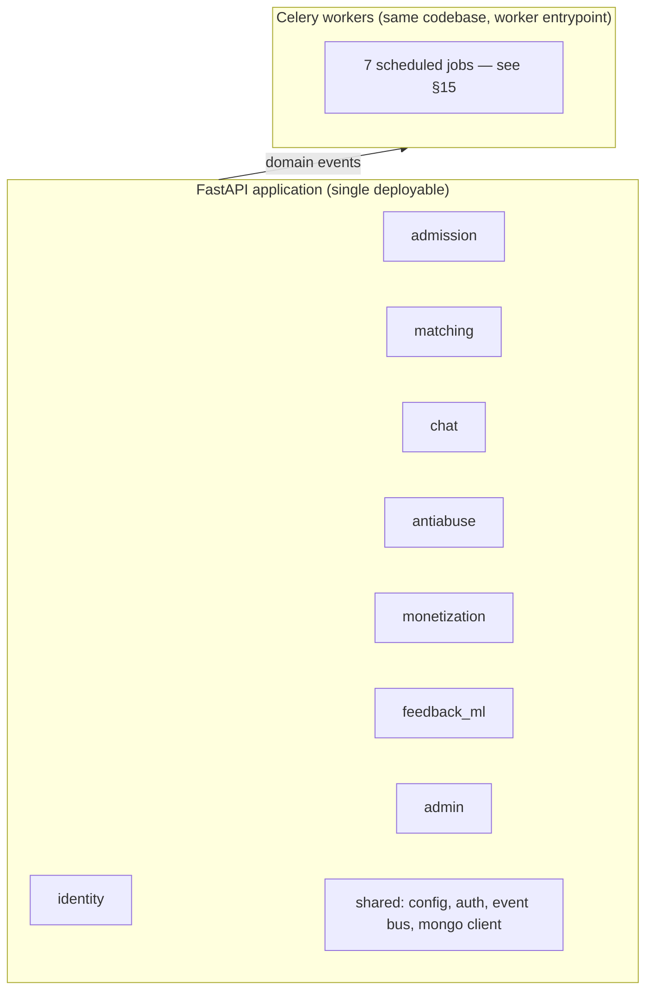
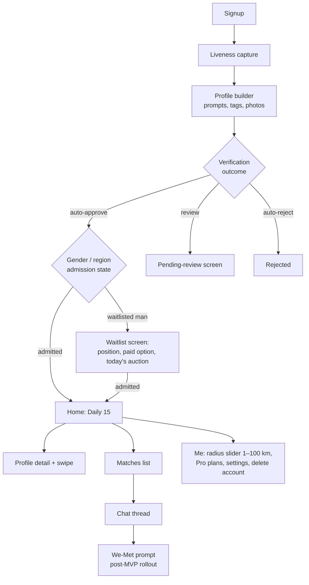
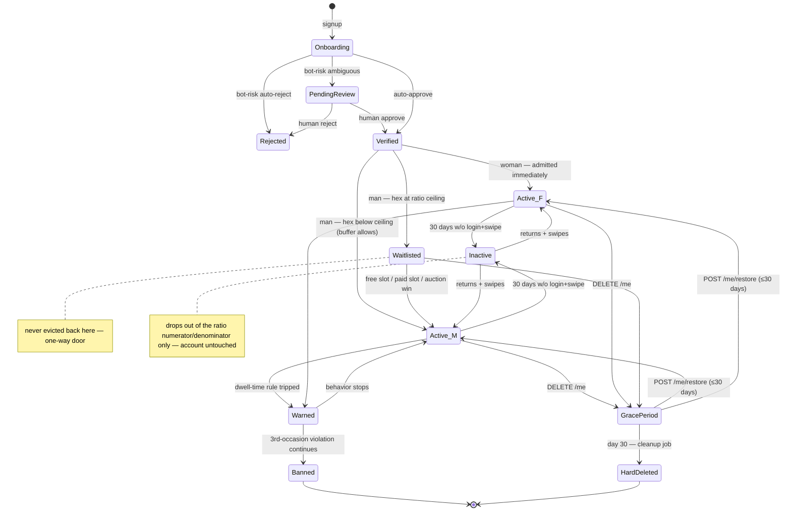
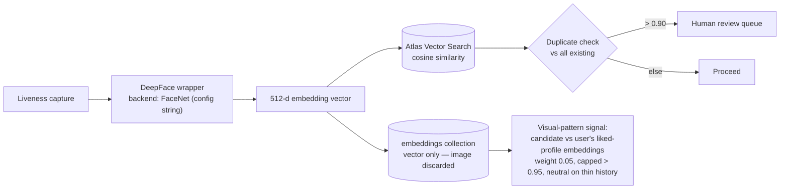
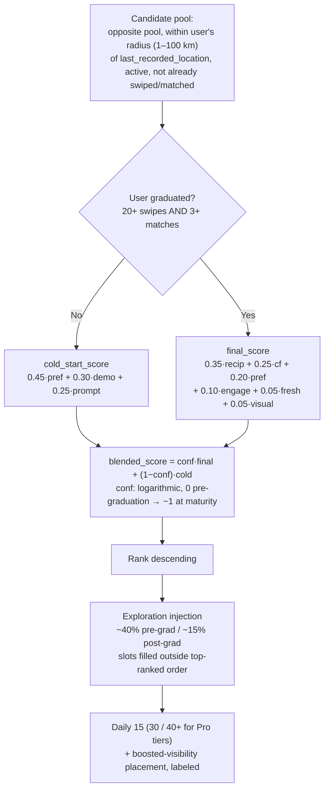
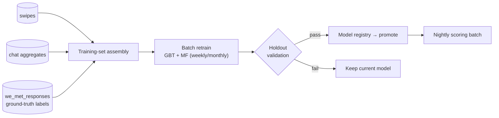

# Sincère — Technical Implementation Plan

> Engineering blueprint for the MVP build. Product rationale lives in [README.md](README.md); plain-English explanations in [APPLICATION_WORKING.md](APPLICATION_WORKING.md); long-term architecture evolution in [ARCHITECTURE_PLAN.md](ARCHITECTURE_PLAN.md).
>
> **Convention:** values from the project decision record are marked **(DECIDED)**. Stack/infra choices the record is silent on are marked *(assumed)* and were chosen to be consistent across the documentation suite: Python 3.11 + FastAPI modular monolith, Celery + Redis for jobs, React Native client, S3-compatible object storage.

---

## Table of Contents

1. [Functional Requirements](#1-functional-requirements)
2. [Non-Functional Requirements](#2-non-functional-requirements)
3. [Backend Implementation](#3-backend-implementation)
4. [Frontend Implementation](#4-frontend-implementation)
5. [Authentication Flow](#5-authentication-flow)
6. [User Lifecycle](#6-user-lifecycle)
7. [API Design](#7-api-design)
8. [Database Schema](#8-database-schema)
9. [AI Integration](#9-ai-integration)
10. [Recommendation Engine](#10-recommendation-engine)
11. [Matching Algorithm](#11-matching-algorithm)
12. [Ranking Formulas](#12-ranking-formulas)
13. [ML Models](#13-ml-models)
14. [Event Flow](#14-event-flow)
15. [Queues](#15-queues)
16. [Caching](#16-caching)
17. [Notifications](#17-notifications)
18. [Security](#18-security)
19. [Performance](#19-performance)
20. [Scaling Considerations](#20-scaling-considerations)
21. [Monitoring](#21-monitoring)
22. [Logging](#22-logging)
23. [CI/CD](#23-cicd)
24. [Testing Strategy](#24-testing-strategy)
25. [Rollout Plan](#25-rollout-plan)

---

## 1. Functional Requirements

### FR-1 Onboarding & Identity

| ID | Requirement |
|---|---|
| FR-1.1 | Signup collects profile basics, prompts, interest/lifestyle tags, and gender |
| FR-1.2 | Liveness verification at signup: short in-app selfie/video with randomized prompts (blink, head turn) **(DECIDED)** |
| FR-1.3 | Generate a FaceNet embedding (via DeepFace) from the verification capture **(DECIDED)** |
| FR-1.4 | Duplicate check: new embedding vs. all existing embeddings via Atlas Vector Search; **>90% cosine similarity → human review**, never auto-ban **(DECIDED)** |
| FR-1.5 | Profile-photo-to-verification-selfie match (blocks the "verify real face, swap in stolen photos" scam) |
| FR-1.6 | Composite bot-risk score routes signups into **auto-approve / auto-reject / human-review** bands; human review only for the ambiguous middle (~5–15% of flagged, illustrative) **(DECIDED)** |
| FR-1.7 | Human review queue handled **in-house (founder) at launch** **(DECIDED)**; every decision logs agreement/disagreement with the automated score for threshold retuning |

### FR-2 Admission, Ratio & Waitlist

| ID | Requirement |
|---|---|
| FR-2.1 | Assign every user to the H3 **resolution-6** hex containing their signup location; that hex is their admission region **(DECIDED)** |
| FR-2.2 | Each hex runs an independent queue instance: active counts, waitlist, three tiers, auction **(DECIDED)** |
| FR-2.3 | Active user = logged in within last 30 days **AND** ≥1 swipe/like in that window **(DECIDED)** |
| FR-2.4 | Hysteresis admission control: freeze male admissions at `active_men ≤ active_women × 1.05`; resume when women recover past `× 0.95` **(DECIDED)** |
| FR-2.5 | Admission buffer: admit men up to ~90–95% of active-women count **(DECIDED)** |
| FR-2.6 | **Never evict** existing men on ratio dip — freeze new admissions only **(DECIDED)** |
| FR-2.7 | Daily admission slots split **60% free / 25% paid / 15% auction**; all three draw from the same ratio ceiling **(DECIDED)** |
| FR-2.8 | Paid queue: **fixed price** (no surge) **(DECIDED)**; exact price open |
| FR-2.9 | Auction: live ascending-bid, **once daily, fixed window**, top bidders at close win that day's auction slots **(DECIDED)**; exact window time open |
| FR-2.10 | Waitlist priority within the free queue weighted by **engagement quality**, not pure FIFO **(DECIDED)** |
| FR-2.11 | Auction/paid entrants receive **no compatibility-score advantage** **(DECIDED)** |

### FR-3 Matching & Discovery

| ID | Requirement |
|---|---|
| FR-3.1 | Deliver **15 curated matches/day** per user (hybrid model) **(DECIDED)**; delivery timing (all-at-once vs. trickle) open |
| FR-3.2 | Candidate pool = opposite-pool users within the user's slider radius (**1–100 km**) of `last_recorded_location` **(DECIDED)** |
| FR-3.3 | `last_recorded_location` captured **on every app open** — no continuous background GPS **(DECIDED)** |
| FR-3.4 | Cold-start scoring for pre-graduation users; graduation at **20+ swipes AND 3+ matches**; blended (not hard) switch to learned scoring **(DECIDED)** |
| FR-3.5 | Exploration injection: ~40% of the daily 15 pre-graduation, ~15% post-graduation **(DECIDED, illustrative %)** |
| FR-3.6 | Visual-pattern similarity input at fixed weight **0.05**, capped/discounted >0.95 cosine, neutral (0.5) for thin like-history **(DECIDED)** |

### FR-4 Chat & Feedback Loop

| ID | Requirement |
|---|---|
| FR-4.1 | In-app chat between matched pairs — **MVP scope** (data source for engagement, reciprocity training, churn signals) **(DECIDED)** |
| FR-4.2 | Track per-match message count and response latency → `engagement_score` and churn-risk features |
| FR-4.3 | "We Met" prompt fires at **20–30 total messages within a 3-day window** (no per-day minimum) **(DECIDED)**; re-fires every 1–2 weeks on "not yet met" until met or unmatched **(DECIDED)**; rollout shortly post-MVP |
| FR-4.4 | We-Met responses accumulate as ground-truth labels for **periodic batch retraining** (weekly/monthly, cadence TBD by volume) **(DECIDED)** |

### FR-5 Anti-Abuse

| ID | Requirement |
|---|---|
| FR-5.1 | Record dwell time (profile view duration before swipe) on every swipe |
| FR-5.2 | Flag: **<10 s dwell on >70% of right-swipes** over a rolling window **(DECIDED launch defaults)** |
| FR-5.3 | Escalation: 3 in-app warnings on **separate occasions**, then ban **(DECIDED)** — a dedicated warning/ban track, separate from bot-risk routing |
| FR-5.4 | Behavioral/device signals: fingerprint reuse, IP clustering, uniform swipe timing, signup velocity per referral source, spam-template bio detection |

### FR-6 Monetization

| ID | Requirement |
|---|---|
| FR-6.1 | Two-tier Pro subscription — **Basic Pro / Pro Plus**, available to **both genders** **(DECIDED)**; exact split/pricing open. Illustrative: Basic Pro = 30 matches/day, undo swipe, advanced filters; Pro Plus = all that + "see who liked you," 40+/day, boosted visibility |
| FR-6.2 | Boosted profiles **must be labeled "Boosted"** to viewers **(DECIDED)**; boost never touches compatibility score |
| FR-6.3 | Entry-tier visibility (how a man entered: free/paid/auction) shown only to women holding a Pro subscription **(DECIDED)** — flagged for reception monitoring post-launch |
| FR-6.4 | Base access (15/day) is free forever for active users — never revoked **(DECIDED)** |
| FR-6.5 | GST invoicing records place-of-supply (state) from billing address — backend bookkeeping only, zero effect on queue/matching **(DECIDED)** |

### FR-7 Data Retention & Deletion

Implements the account-deletion cascade and per-category retention rules — see [§8 Database Schema](#8-database-schema) retention column and [§18 Security](#18-security). All timelines **(DECIDED)**, pending legal confirmation (decision record §11.1).

### FR-8 Admin/Ops

| ID | Requirement |
|---|---|
| FR-8.1 | Dashboard: per-region ratio health, queue/waitlist/auction state, flagged-account review queue, monetization metrics |
| FR-8.2 | Review actions (approve/reject) with decision-vs-score agreement logging (feeds threshold retuning) |

---

## 2. Non-Functional Requirements

| Category | Requirement | Notes |
|---|---|---|
| Latency | p95 < 300 ms for interactive reads (daily 15 fetch, profile, chat history); p95 < 150 ms for swipe writes | Daily 15 is precomputed by batch, so the read is a lookup |
| Chat delivery | < 1 s in-session message delivery via WebSocket | No push notifications in MVP — offline delivery happens on next app open |
| Availability | 99.5% MVP target; 99.9% post-scale | Single-region acceptable for a single-city launch |
| Batch windows | Daily 15 generation completes before delivery time for all users in a region; auction close settles within 1 min of window end | |
| Data protection | Biometric handling per DPDP/GDPR/BIPA posture: embeddings only (no source images), purpose limitation, bounded genuine deletion | See [§18](#18-security) |
| Configurability | All launch-default thresholds (hysteresis band, dwell rules, similarity cutoffs, weights) tunable via config without redeploy | They are explicitly flagged for post-launch refinement |
| Auditability | Every admission decision, review decision, ban, and deletion-cascade step is logged immutably | Fairness claims must be defensible |
| Cost | Managed services (Atlas, Redis) over self-hosted at MVP; infra bill scales with one city's usage | |

---

## 3. Backend Implementation

The backend is a **modular monolith** (full rationale: [ARCHITECTURE_PLAN.md §3](ARCHITECTURE_PLAN.md#3-why-a-modular-monolith-first)). Eight modules mirror the logical services in the decision record §10:



### Module responsibilities

| Module | Owns | Key internals |
|---|---|---|
| `identity` | Signup, liveness capture intake, embedding generation, duplicate check, photo-selfie match, bot-risk composite score + 3-band routing | DeepFace/FaceNet runs here (or as a GPU-backed internal endpoint if CPU inference proves too slow — measure first); Atlas Vector Search queries |
| `admission` | H3 assignment (`lat/lng → h3.latlng_to_cell(…, 6)`), per-hex active counts, hysteresis state machine, 60/25/15 slot allocation, waitlist ordering, auction engine | Auction live state in Redis; settlement writes to MongoDB at close |
| `matching` | Candidate pool query, cold-start/blended/learned scoring, exploration injection, daily 15 assembly | Batch scoring in Celery; serves precomputed lists at request time |
| `chat` | Messages, WebSocket sessions, per-match `message_count` / `response_latency` aggregates | Emits `MessageSent` events consumed by matching (engagement) and feedback_ml (We-Met trigger) |
| `antiabuse` | Dwell-time aggregation, 70%-rule detection, warning ledger, ban enforcement | Separate track from identity's bot-risk routing by design **(DECIDED)** |
| `monetization` | Pro subscriptions, paid-queue checkout, auction payments, boosted labeling, entry-tier visibility gate, GST place-of-supply invoicing | Payment aggregator adapter behind an interface (vendor TBD) |
| `feedback_ml` | We-Met prompt scheduling/response capture, training-set assembly, batch retraining orchestration, model registry | Models validated against a holdout set before promotion **(DECIDED)** |
| `admin` | Dashboard APIs, review queue, threshold configuration endpoints | |

### Hard boundary rules

1. A module's MongoDB collections are written **only** by that module.
2. Cross-module reads go through the owning module's public Python interface (`sincere/<module>/api.py`), never raw collection access.
3. Cross-module *reactions* go through domain events (in-process bus at MVP; see [§14](#14-event-flow)).
4. `shared/` contains only genuinely cross-cutting code (auth, config, event bus, serialization) — no business logic.

These rules are what make the later microservice extraction cheap ([ARCHITECTURE_PLAN.md §9](ARCHITECTURE_PLAN.md#9-migration-plan-monolith--microservices)).

---

## 4. Frontend Implementation

*(assumed: React Native)* — the decision record specifies product behavior, not client tech.

### Screen map



### Client responsibilities that carry product logic

| Behavior | Implementation |
|---|---|
| Location capture | On every app foreground: fetch GPS once, `POST /me/location`. No background location permission requested — this is a product decision **(DECIDED)** and a privacy selling point |
| Dwell-time measurement | Client timestamps profile-visible → swipe; sends `dwell_ms` with `POST /swipes`. Server treats it as untrusted input (see [§18](#18-security)) and cross-checks against server-side fetch timing |
| Radius slider | 1–100 km, writes `PATCH /me/radius`; copy makes clear it affects matches only, never queue position |
| Liveness capture | Camera flow issues server-provided randomized prompts (blink, head turn); uploads short video to a pre-signed object-storage URL |
| Chat | WebSocket when app open; on reconnect, delta-sync via `GET /matches/:id/messages?after=` |
| No-push UX (MVP) | Badge counts refresh on app open; explicitly no push until v2 **(DECIDED)** |
| Boosted label | Renders the mandatory "Boosted" tag whenever the profile payload carries `boosted: true` |
| Warnings | Renders anti-abuse warning interstitials (1st/2nd/3rd occasion) distinctly from ban notice |

---

## 5. Authentication Flow

*(assumed mechanics: phone-OTP primary — the norm for India-market apps — with JWT access + rotating refresh tokens; the decision record does not specify an auth method.)*

```mermaid
sequenceDiagram
    autonumber
    participant C as Mobile client
    participant API as API (identity module)
    participant DB as MongoDB
    participant OS as Object storage

    C->>API: POST /auth/signup {phone}
    API->>C: OTP sent
    C->>API: POST /auth/verify-otp {phone, otp}
    API->>DB: create user (status=onboarding)
    API->>C: JWT access + refresh (scope: onboarding only)
    C->>API: profile data, photos
    C->>API: request liveness session
    API->>C: randomized prompt sequence + pre-signed upload URL
    C->>OS: upload liveness video
    C->>API: POST /verification/liveness {captureRef}
    API->>API: liveness check → FaceNet embedding → duplicate search → photo-selfie match → bot-risk score
    alt auto-approve
        API->>DB: status=verified → hand off to admission module
        API->>C: full-scope tokens (women & admitted men: active; waitlisted men: waitlist scope)
    else ambiguous band
        API->>C: status=pending review (in-house queue)
    else auto-reject
        API->>C: rejected
    end
```

Token rules:

- Short-lived access JWT (~15 min), rotating refresh (~30 days — matching the activity window definition).
- Token **scopes mirror lifecycle state**: `onboarding` → `waitlisted` → `active`; a waitlisted man's token cannot call matching/chat endpoints.
- Refresh rotation with reuse detection (a replayed refresh token revokes the family).
- WebSocket auth: access JWT presented at connect; connection dropped on expiry, client silently reconnects after refresh.

---

## 6. User Lifecycle



Lifecycle notes:

- **`Inactive` affects only the ratio denominators** — the account, matches, and chats are untouched. This is what makes "active ratio" honest: churned women stop counting, which is exactly when the hysteresis freeze kicks in.
- **Deletion cascade (DECIDED shape):** immediate hide + removal from all pools/queues → 30-day recoverable soft-delete (profile **and** liveness captures) → hard delete of profile, photos, chat (per the 90-day post-unmatch rule where applicable), captures, and embeddings. Payment records survive separately per financial regulation (5–7 years).
- A banned user's embedding persists (account-lifetime retention) so re-signup is caught by the duplicate check.

---

## 7. API Design

REST + one WebSocket. All routes JWT-authenticated except signup/OTP. Versioned under `/v1`.

### Identity & Verification

| Method | Route | Notes |
|---|---|---|
| POST | `/auth/signup` | phone → OTP |
| POST | `/auth/verify-otp` | → onboarding-scope tokens |
| POST | `/auth/refresh` | rotating refresh |
| POST | `/verification/liveness` | submit capture ref; triggers pipeline (FR-1.2–1.6) |
| GET | `/verification/status` | onboarding / pending-review / verified / rejected |

### Profile & Location

| Method | Route | Notes |
|---|---|---|
| GET / PATCH | `/me` | profile, prompts, tags |
| PATCH | `/me/radius` | 1–100 km slider value |
| POST | `/me/location` | on app open → updates `last_recorded_location`; server derives H3 cell |
| DELETE | `/me` | starts 30-day grace period |
| POST | `/me/restore` | within grace period |

### Queue, Waitlist, Auction

| Method | Route | Notes |
|---|---|---|
| GET | `/queue/status` | tier, position, region admission state (open/frozen) |
| POST | `/queue/paid/checkout` | fixed price; on payment success → paid-queue placement |
| GET | `/auction/today` | window times, current top bids (anonymized), slots available |
| POST | `/auction/bid` | ascending-bid; rejected if ≤ current standing requirement |
| GET | `/auction/result` | post-close outcome; losers auto-refunded via aggregator |

### Matching & Swipes

| Method | Route | Notes |
|---|---|---|
| GET | `/matches/daily` | today's precomputed 15 (30/40+ for Pro); includes `boosted` flags |
| POST | `/swipes` | `{targetId, direction, dwell_ms}`; response includes `matched: bool` |
| GET | `/matches` | active matches list |
| DELETE | `/matches/:id` | unmatch → starts 90-day message-retention clock |

### Chat

| Method | Route | Notes |
|---|---|---|
| GET | `/matches/:id/messages?after=` | paginated history / reconnect delta |
| POST | `/matches/:id/messages` | REST fallback |
| WS | `/ws/chat` | send/receive, delivery + read receipts |
| POST | `/matches/:id/report` | harassment report → pauses that conversation's retention clock **(DECIDED)** |

### We Met (post-MVP rollout)

| Method | Route | Notes |
|---|---|---|
| GET | `/wemet/pending` | prompts awaiting answer |
| POST | `/wemet/:promptId/response` | `met_yes / met_no_yet / not_going_to`; `met_no_yet` schedules re-ask in 1–2 weeks |

### Monetization

| Method | Route | Notes |
|---|---|---|
| GET | `/pro/plans` | Basic Pro / Pro Plus |
| POST | `/pro/subscribe` / DELETE `/pro/subscription` | via aggregator |
| GET | `/profiles/:id/entry-tier` | 403 unless caller is a Pro-subscribed woman **(DECIDED gate)** |
| POST | `/webhooks/payments` | aggregator webhook (signature-verified) |

### Admin

| Method | Route | Notes |
|---|---|---|
| GET | `/admin/regions` / `/admin/regions/:h3` | ratio health, hysteresis state, queue depths |
| GET | `/admin/review-queue` | ambiguous-band accounts |
| POST | `/admin/review/:flagId/decision` | approve/reject + agreement logging (FR-8.2) |
| GET | `/admin/metrics/monetization` | |
| PATCH | `/admin/config/thresholds` | tunable launch defaults (audited) |

Error model: RFC-7807 problem+json; idempotency keys on payment and bid endpoints; per-user rate limits (see [§18](#18-security)).

---

## 8. Database Schema

MongoDB. Illustrative documents; `*` marks indexed fields.

```js
// users — owned by identity + profile concerns
{
  _id, phone_hash*, gender, status*,            // onboarding|pending_review|active|waitlisted|banned|grace_period
  profile: { name, dob, bio, prompts: [{q, a}], tags: [String], photos: [{url, is_boost_labeled}] },
  last_recorded_location: { type: "Point", coordinates: [lng, lat] },   // 2dsphere index*
  h3_region*: String,                            // res-6 cell of signup/current admission region
  radius_km: Number,                             // 1–100
  activity: { last_login_at*, last_swipe_at*, is_active_30d* },        // ratio basis (DECIDED definition)
  graduation: { swipes: Number, matches: Number, graduated_at },
  entry_tier: "free" | "paid" | "auction",       // men; Pro-gated visibility
  warnings: [{ at, occasion_no }],               // anti-abuse ledger (3 → ban)
  deleted_at, hard_delete_after                   // 30-day grace mechanics
}

// embeddings — vectors only, never source images (DECIDED)
{ _id, user_id*, vector: [Number/*512-d FaceNet*/], purpose: "duplicate_and_visual_pattern", created_at }
// Atlas Vector Search index on `vector`, cosine similarity

// verification_captures — soft-delete 30 days → hard delete (DECIDED)
{ _id, user_id*, object_key, liveness_result, prompt_sequence, created_at, hard_delete_after* }

// swipes
{ _id, user_id*, target_id*, direction, dwell_ms, created_at* }        // TTL/rolling per anti-spam window

// matches
{ _id, users*: [uid, uid], region, formed_at, status: "active"|"unmatched",
  engagement: { msg_count, last_msg_at, avg_response_latency_s },       // feeds engagement_score
  wemet: { triggered_at, responses: [...], next_reask_at } ,
  unmatched_at, messages_purge_after }                                  // 90-day rule (DECIDED)

// messages
{ _id, match_id*, sender_id, body, sent_at*, delivered_at, read_at, retention_hold: Boolean }  // hold = harassment investigation

// queues — one doc per H3 region (DECIDED per-hex instances)
{ _id: h3_cell, active_men, active_women, admission_state: "open"|"frozen",
  waitlist: [{ user_id, tier: "free"|"paid", joined_at, engagement_priority }],
  auction: { window_start, window_end, slots, bids: [{ user_id, amount, at }] },
  slot_split: { free: 0.60, paid: 0.25, auction: 0.15 } }

// subscriptions
{ _id, user_id*, tier: "basic_pro"|"pro_plus", status, renews_at, aggregator_ref }

// bot_risk_flags
{ _id, user_id*, composite_score, band: "auto_approve"|"review"|"auto_reject",
  signals: { duplicate_sim, device_reuse, ip_cluster, swipe_timing, signup_velocity, bio_template },
  review: { decided_by, decision, agreed_with_score, decided_at } }

// we_met_responses — ground-truth labels for retraining
{ _id, match_id*, user_id, response, responded_at }

// device_signals — 90-day rolling window (DECIDED); TTL index on created_at
{ _id, user_id*, fingerprint*, ip*, event_type, created_at* }

// invoices — GST place-of-supply from billing address (DECIDED bookkeeping detail)
{ _id, user_id, amount, gst: { place_of_supply_state, cgst, sgst, igst }, aggregator_ref, created_at }
// payment records retained per financial regulation, decoupled from account deletion (DECIDED)
```

Key indexes: `users.last_recorded_location` (2dsphere — powers radius filtering), `users.h3_region + gender + activity.is_active_30d` (ratio counts), `swipes.user_id + created_at` (graduation + anti-spam), `messages.match_id + sent_at`, TTL indexes implementing the 90-day device-signal purge, and scheduled-job-driven deletes where TTL semantics don't fit (grace-period cascade, post-unmatch message purge with investigation holds).

---

## 9. AI Integration

One embedding pipeline, two sanctioned uses **(DECIDED)** — duplicate detection and personalized visual-pattern matching. Nothing else; explicitly **never marketing** (fresh separate consent would be required and is not planned).



Constraints carried from the decision record:

- **Cosine similarity only** — never decompose into named facial features (legal posture: similarity-only embeddings vs. "facial geometry" statutory language).
- **Per-user-relative** visual-pattern scores — no universal attractiveness metric exists anywhere in the system.
- FaceNet chosen for **clean commercial licensing**; accuracy tradeoff vs. ArcFace accepted knowingly; swappable later via DeepFace's config-string abstraction if InsightFace is ever licensed.
- Data minimization: source images discarded after embedding; verification captures follow the 30-day soft-delete rule.
- **Blocking dependency:** the combined legal review (biometric consent language per jurisdiction) must complete before this pipeline ships.

---

## 10. Recommendation Engine

The engine answers one question daily per user: *which 15 profiles, in what order?*



Notes:

- Pre-graduation, `confidence = 0`, so `blended_score` degenerates to pure `cold_start_score` — one formula covers all lifecycle stages.
- Reciprocity is substituted with **coarse population-level priors** (age-range overlap, distance decay) until real reciprocity data accumulates **(DECIDED cold-start strategy)**.
- Cold start resets **per hex region** at each region's launch (admission-side maturity), while candidate pools remain purely radius-based — the two-geography separation again.
- Boosted (Pro Plus) placement adjusts *visibility position*, never the score itself, and is always labeled.

---

## 11. Matching Algorithm

Pipeline stages for the nightly batch (per region-active user):

1. **Pool query** — `$geoNear` on `last_recorded_location` within `radius_km`, filtered to active, verified, opposite-pool, not-previously-swiped, not-currently-matched users. Both directions' radius preferences are respected (each candidate must also have the user inside *their* radius).
2. **Feature assembly** — per (user, candidate) pair, compute/fetch the variables in [§12](#12-ranking-formulas). Cached user-level vectors (tags, prompt embeddings, liked-profile embedding centroid) make this O(pool) rather than O(pool²).
3. **Scoring** — cold-start / final / blended per graduation state.
4. **Reciprocity symmetric check** — the candidate's predicted like-back probability is *the* heaviest signal (0.35); the model scores P(candidate → user), not just P(user → candidate).
5. **Exploration injection** — reserve ~40%/15% of slots for candidates sampled outside top-rank order (uniform-over-eligible at MVP; bandit-style selection is a post-launch refinement).
6. **Fairness/consistency constraints** — score parity for auction/paid entrants **(DECIDED)**: entry tier is not a scoring feature, full stop.
7. **Delivery** — persist the ordered 15 to a `daily_batches` cache/collection; client fetches at `GET /matches/daily`. All-at-once vs. trickled delivery is an open product decision; the batch design supports both (trickle = staged reveal of the same precomputed list).

Anti-spam interlock: swipes recorded with `dwell_ms`; the antiabuse module evaluates the 70%-under-10s rule on a rolling window and escalates warnings independently of scoring — low-intent swiping is a conduct problem, not a ranking penalty **(DECIDED)**.

---

## 12. Ranking Formulas

Canonical variable reference (mirrors the decision record §2; plain-English versions in [APPLICATION_WORKING.md §Ranking](APPLICATION_WORKING.md#7-ranking-formulas-explained)):

| Variable | Computation | Range |
|---|---|---|
| `preference_similarity` | Cosine similarity of stated-interest/tag vectors | 0–1 |
| `demographic_fit` | Function of age gap + distance, normalized | 0–1 |
| `prompt_text_similarity` | Embedding cosine similarity of onboarding prompt answers | 0–1 |
| `reciprocity_prediction` | GBT model output: P(candidate likes user back) | 0–1 |
| `collaborative_filtering` | Matrix-factorization affinity score over platform swipe history | 0–1 (normalized) |
| `engagement_score` | Recency-weighted, per-match, from chat message count + response latency; decays on stagnation | 0–1 |
| `freshness_boost` | Decay function of days-since-signup | 0–1 |
| `visual_pattern_similarity` | Cosine(candidate embedding, user's liked-profile embeddings); capped >0.95; 0.5 default on thin history | 0–1 |
| `confidence` | Logarithmic in post-graduation swipe count, → 1.0 | 0–1 |
| `exploration_rate` | ~0.40 pre-graduation, ~0.15 post | fixed |
| `swipe_ratio` | % of right-swipes with dwell <10 s, rolling window — **anti-spam only, not a scoring input** | 0–1 |

**Formulas (DECIDED structure; weights illustrative except visual = 0.05 fixed):**

```
cold_start_score = 0.45·preference_similarity
                 + 0.30·demographic_fit
                 + 0.25·prompt_text_similarity

final_score      = 0.35·reciprocity_prediction
                 + 0.25·collaborative_filtering
                 + 0.20·preference_similarity
                 + 0.10·engagement_score
                 + 0.05·freshness_boost
                 + 0.05·visual_pattern_similarity      // fixed (DECIDED)

blended_score    = confidence·final_score + (1 − confidence)·cold_start_score

confidence(n)    = min(1, log(1 + n) / log(1 + N_mature))   // illustrative log form (DECIDED: diminishing-returns curve)
                   // n = post-graduation swipes; N_mature = swipes at full confidence (tunable)
```

Rationale for the log curve **(DECIDED)**: early post-graduation swipes carry the most new information, so model weight should rise fast then flatten — rather than a linear ramp (wastes early signal) or step function (jarring transition).

---

## 13. ML Models

| Model | Method (DECIDED) | Inputs | Output | Training cadence |
|---|---|---|---|---|
| Reciprocity prediction | Gradient-boosted trees (XGBoost/LightGBM) | Shared interests, distance, activity level, chat-derived engagement features | P(candidate likes user back) | Periodic batch (weekly/monthly), holdout-validated before promotion |
| Collaborative filtering | Matrix factorization (SVD/ALS) | Platform-wide swipe matrix | User/item latent factors → affinity | Same batch cadence |
| Face embeddings | FaceNet (via DeepFace) | Verification capture / profile photos | 512-d vector | Pretrained — no in-house training |
| Churn-risk flagging | Heuristic at launch (declining sessions/matches/message frequency, growing response latency); model candidate later | Session + chat aggregates | At-risk flag (women prioritized for proactive retention) | Rule-based initially |

**Why the simpler methods (DECIDED rationale):** logistic regression is too simplistic for non-linear feature interactions; factorization machines / two-tower networks / DCN / neural CF / GNNs all need data volume a pre-launch app doesn't have. GBT + MF is the best complexity-to-value ratio now; upgrades are scale-triggered roadmap items.

**Retraining loop:**



The We-Met loop is what re-anchors both models to *real-world* compatibility rather than in-app swipe appeal — closing the "matched ≠ actually compatible" gap **(DECIDED purpose)**.

---

## 14. Event Flow

Domain events (in-process bus at MVP; broker-backed later — [ARCHITECTURE_PLAN.md §7](ARCHITECTURE_PLAN.md#7-event-driven-architecture--async-communication)):

| Event | Emitted by | Consumed by | Effect |
|---|---|---|---|
| `UserVerified` | identity | admission | Enter admission flow (women/buffer-space men: activate; else waitlist) |
| `UserActivated` | admission | matching | Include in next scoring batch; start freshness boost |
| `ActiveStatusChanged` | shared activity tracker | admission | Recompute hex ratio → hysteresis state machine |
| `SwipeRecorded` | matching | antiabuse, matching | Dwell-rule evaluation; graduation counters |
| `MatchFormed` | matching | chat | Open conversation |
| `MessageSent` | chat | matching, feedback_ml, admission | Engagement aggregates; We-Met trigger check; churn-signal input |
| `WeMetThresholdReached` | feedback_ml | feedback_ml | Schedule prompt (20–30 msgs / 3 days) |
| `Unmatched` | matching | chat | Start 90-day message-retention clock |
| `HarassmentReported` | chat | chat, admin | Retention hold; surface to review |
| `PaymentSucceeded` | monetization | admission | Paid-queue placement / auction bid validity / Pro activation |
| `AuctionClosed` | admission | monetization, admission | Charge winners, refund losers, admit winners |
| `WarningIssued` / `UserBanned` | antiabuse | identity, admission | Ledger update; ban removes from pools, embedding retained |
| `AccountDeletionRequested` | identity | all modules | Immediate hide + pool/queue removal; schedule 30-day cascade |

End-to-end example — a message's ripple effects:

```mermaid
sequenceDiagram
    participant U as User A (app open)
    participant CH as chat
    participant MT as matching
    participant FM as feedback_ml
    participant AQ as admission

    U->>CH: send message (WebSocket)
    CH->>CH: persist; update match msg_count, response latency
    CH-->>MT: MessageSent → engagement_score refresh (recency-weighted)
    CH-->>FM: MessageSent → We-Met trigger check (20–30 in 3-day window?)
    CH-->>AQ: MessageSent → churn-risk features (frequency/latency trends)
    Note over AQ: declining frequency + growing latency<br/>→ flag at-risk woman proactively (DECIDED)
```

---

## 15. Queues

Two distinct meanings — kept terminologically separate throughout the suite:

### a) Product queues (admission system)

Per-hex three-tier admission (free 60% / paid 25% / auction 15%), hysteresis-governed. State in the `queues` collection; live auction bidding state in Redis (sorted set by bid amount) with periodic snapshot + settlement-time write-through to MongoDB.

### b) Infrastructure job queues *(assumed: Celery on Redis)*

| Job | Schedule | Source (decision record §10) |
|---|---|---|
| Daily 15 match-generation batch | Nightly per region (before delivery time) | Matching |
| Daily auction close | Fixed daily window end | Admission |
| Ratio/hysteresis recompute | Event-triggered on active-count changes (+ hourly sweep as backstop) | Admission |
| Churn-risk flagging | Daily scan | Admission/Chat signals |
| Batch model retraining | Weekly/monthly | Feedback & ML |
| We-Met prompt scheduler | Continuous trigger checks + 1–2-week re-ask timers | Feedback & ML |
| Retention cleanup | Daily: 30-day grace hard-deletes; 90-day chat purge post-unmatch (honoring investigation holds); 90-day device-signal purge | All retention rules §7 of decision record |

Job requirements: idempotent (safe re-run), per-region parallelizable (match batch), dead-letter + alerting on repeated failure (a silently skipped auction close or retention purge is a business/legal incident, not just a bug).

---

## 16. Caching

*(assumed: Redis)*

| Cached item | TTL / invalidation | Why |
|---|---|---|
| Daily 15 per user | Until next batch | The single hottest read; precomputed by design |
| Per-hex ratio counters + hysteresis state | Event-invalidated; hourly recompute backstop | Read on every admission decision |
| Live auction state (standing bids, slots) | Life of daily window; settled to MongoDB at close | High-frequency writes during window |
| Session / token metadata, refresh-reuse detection | Token lifetime | Auth hot path |
| User feature vectors (tag vector, prompt embedding, liked-centroid) | Invalidate on profile edit / new like | Makes nightly scoring O(pool) |
| Rate-limit counters | Rolling windows | §18 |
| WebSocket presence (match → connected sockets) | Connection lifetime | Chat routing across API replicas (Redis pub/sub) |

Non-goals at MVP: no CDN-level API caching (personalized responses), no cross-region cache (single region). Profile photos served via CDN from object storage ([ARCHITECTURE_PLAN.md §10](ARCHITECTURE_PLAN.md#10-infrastructure)).

---

## 17. Notifications

**Push notifications are deferred to v2 (DECIDED — unchanged).** MVP notification surface:

| Channel | MVP behavior |
|---|---|
| In-app (on open) | Badge counts + inbox for: new matches, new messages, waitlist admission, auction results, warnings, We-Met prompts |
| WebSocket (app open) | Real-time chat delivery, match-formed toast |
| SMS *(assumed)* | OTP only — no marketing/engagement SMS |
| Push (v2) | Design constraint now: the notifications module is event-consuming from day one, so v2 push = adding a delivery adapter (FCM/APNs), not re-plumbing. Daily-15 delivery-timing decision (all-at-once vs. trickle) should be finalized alongside push design since trickle is primarily a notification-cadence strategy |

Implication accepted in the decision record: MVP users discover new activity by reopening the app. This raises the value of the daily-15 rhythm as the habitual reason to open.

---

## 18. Security

### Authentication & transport

- JWT scopes bound to lifecycle state ([§5](#5-authentication-flow)); refresh rotation with reuse detection.
- TLS everywhere; HSTS; certificate-pinning consideration for the mobile client.
- Webhook signature verification (payments); idempotency keys on money-moving endpoints.

### Biometric & privacy posture (from decision record §3, §7)

| Rule | Implementation |
|---|---|
| Embeddings only, never source images, in `embeddings` | Enforced at the pipeline level — image buffer discarded post-embedding |
| Similarity-only — no named facial features | No code path extracts/labels facial attributes |
| Purpose limitation: verification + visual-pattern only; **never marketing** | Single `purpose` field; any new purpose requires fresh consent flow |
| Bounded genuine deletion | 30-day grace → hard delete embeddings + captures; jurisdiction-faster if mandated; "soft-delete forever" explicitly rejected |
| Location minimalism | Single `last_recorded_location` value, overwritten on app open — no history log exists to breach |
| Chat retention | 90 days post-unmatch; investigation holds pause the clock |
| Device signals | 90-day rolling TTL |
| **Gate:** legal review before face-analysis code ships | Decision record §11.1 — hard blocker |

### Abuse & fraud

- Full signup pipeline: liveness (randomized prompts defeat static/stolen photos and replayed deepfakes), duplicate embedding check, photo-selfie match, device/behavioral signals → composite score → 3-band routing.
- Dwell-time anti-spam with graduated warnings ([§1 FR-5](#fr-5-anti-abuse)); client-reported `dwell_ms` is cross-checked server-side (profile-payload fetch time vs. swipe time) since the client is untrusted.
- Rate limits: OTP issuance, swipe velocity, message velocity, bid frequency.
- Admin actions audited; threshold changes logged with actor + before/after.

### Payments

- No card data touches Sincère servers — aggregator-hosted flows (also narrows PCI-DSS scope). Payment records retained 5–7 years per financial regulation, decoupled from the account-deletion cascade **(DECIDED)**.

---

## 19. Performance

| Hot path | Design for speed |
|---|---|
| `GET /matches/daily` | Precomputed nightly — request time is a cache/collection lookup |
| `POST /swipes` | Single insert + counter increments; event fan-out async |
| Chat send | WebSocket + single insert; aggregates updated async |
| Duplicate check (signup) | Atlas Vector Search ANN query — signup is not latency-critical (seconds acceptable); embedding generation is the dominant cost, run async with a "verifying…" client state |
| Nightly batch | Per-region parallel Celery tasks; per-user pool capped (geo-query limit) before scoring; user-level feature vectors cached ([§16](#16-caching)) |
| Ratio recompute | Counter-maintained (increment/decrement on events), not recounted per decision; hourly full recount as drift correction |

Batch complexity control: with pools capped at a few thousand candidates and cached feature vectors, scoring is linear per user; MF affinity is a dot product; GBT inference batched. A single worker pool comfortably covers a one-city launch; per-region parallelism is the scale lever after that.

---

## 20. Scaling Considerations

Summarized here; full treatment in [ARCHITECTURE_PLAN.md §§8–11](ARCHITECTURE_PLAN.md#8-current-mvp-architecture-vs-future-microservice-architecture).

- **Natural shard key: the H3 region.** Queues, ratio state, cold-start maturity, and match batches are all per-hex — new-city launches add load horizontally without touching existing regions.
- Stateless API replicas behind LB; WebSocket fan-out via Redis pub/sub so chat scales across replicas.
- Read-heavy collections (users, messages) → MongoDB replica-set read scaling first, sharding later (`users` by region, `messages` by match_id).
- First expected extractions from the monolith: **chat** (persistent-connection scaling profile) and **identity's embedding inference** (CPU/GPU-bound) — see migration plan.
- Vector search: Atlas until embedding volume/filtering complexity genuinely bottlenecks; then evaluate Qdrant **(DECIDED trigger condition)**.
- Model serving: in-process at MVP; dedicated serving (or precomputed score tables) when batch windows tighten.

---

## 21. Monitoring

*(assumed: Prometheus + Grafana + Alertmanager; OpenTelemetry traces; Sentry for errors)*

**Business/health metrics (the ones that define this product):**

| Metric | Alert condition |
|---|---|
| Per-hex active_men : active_women ratio | Any region breaching hysteresis band unexpectedly; regions frozen > N days |
| Waitlist depth & wait-time per region/tier | Runaway growth (supply problem) or empty (demand problem) |
| Daily batch completion time | Not done by delivery time |
| Auction settlement | Failure/latency at window close — page immediately |
| Churn-risk flag volume (esp. women) | Spike = leading indicator of ratio trouble |
| Review-queue depth vs. founder capacity | Sustained excess → triggers the vendor-transition roadmap item |
| Retention-cleanup job success | **Any** failure alerts — legally-mandated deletions |
| Payment webhook error rate | Elevated failures |

**System metrics:** API latency (p50/p95/p99) per route, WebSocket connections + delivery latency, Celery queue depth/failure/retry rates, Atlas ops + vector-search latency, Redis memory/evictions.

---

## 22. Logging

- Structured JSON logs, request-ID + user-ID (hashed) correlation, traces linked via OpenTelemetry IDs.
- **Audit log (append-only, separate store/collection):** admission decisions (with ratio inputs at decision time), review decisions (+ score agreement — feeds the threshold-retuning loop, FR-1.7), warnings/bans, deletion-cascade steps, threshold config changes, auction settlements.
- **Never logged:** message bodies (metadata only), raw locations at precision beyond operational need, embedding vectors, OTPs/tokens, payment credentials.
- Log retention itself follows a stated policy (e.g., 90-day app logs / long-lived audit logs) — logs are personal data too under GDPR/DPDP.

---

## 23. CI/CD

*(assumed: GitHub Actions)*


Specifics worth calling out:

- **Module-boundary linting in CI** — the "modules don't import each other's internals" rule ([§3](#3-backend-implementation)) is enforced by tooling, because it's the load-bearing guarantee for the microservice migration.
- **ML deploy path is separate from code deploy:** retrained models go through holdout validation → registry promotion **(DECIDED)**; the app picks up promoted models by reference. Model rollback = repointing the registry, no code deploy.
- Config/threshold changes (hysteresis band, dwell rules, weights) deploy via audited admin config, not code releases.

---

## 24. Testing Strategy

| Layer | Coverage focus |
|---|---|
| Unit | Scoring formulas (cold-start/final/blended/confidence — exact-value tests against hand-computed fixtures); hysteresis state machine (freeze at ×1.05, resume at ×0.95, no flapping under oscillating counts); slot allocation rounding (60/25/15 over small daily slot counts); graduation logic; retention-date computation |
| Property-based | Ratio invariant: **no admission sequence may push active_men above ceiling**; never-evict invariant; auction: winners are exactly the top-k bidders at close |
| Integration | Signup→verification pipeline against a test Atlas cluster (vector search included); deletion cascade end-to-end (assert *everything* scheduled/removed on schedule — this is a compliance test); payment webhook flows against aggregator sandbox |
| Simulation | Synthetic multi-hex population with scripted churn: verify hysteresis behavior, waitlist fairness, batch output sanity (exploration %, no repeats, radius respected both directions) |
| ML | Holdout-set gating on every retrain **(DECIDED)**; drift checks between model versions; cold-start↔learned blend continuity (no score cliffs at graduation) |
| E2E (staging) | Golden path: signup → liveness → (waitlist → auction win) → daily 15 → swipe → match → chat → We-Met prompt → unmatch → retention clock |
| Load | Chat WebSocket concurrency; swipe burst at daily-15 delivery time; auction-close bid spike |
| Security | Auth-scope enforcement (waitlisted token cannot reach matching/chat); rate limits; webhook signature rejection; dwell-ms spoof detection |

---

## 25. Rollout Plan

Phased, aligned with the decision record's soft-launch-first calibration strategy:

| Phase | Gate to advance |
|---|---|
| **0. Pre-build blockers** — combined legal review (biometric consent, retention timelines); payment aggregator selection + sandbox; pricing decisions (paid queue, auction window, Pro tiers) | All three resolved (decision record §11) |
| **1. Internal alpha** — synthetic + team users, one test hex; full pipeline exercised incl. auction with test payments | E2E golden path green; batch + auction jobs reliable |
| **2. Single-city soft launch** — one launch city; concierge-quality onboarding (automated gates first, founder reviews borderline cases — **DECIDED**); high exploration (~40%); ratio system live with launch-default band | Validate H3 res-6 against real 30-day-active data **(DECIDED calibration step)**; review-queue volume within founder capacity; ratio stable without manual intervention |
| **3. Calibration** — tune hysteresis band, buffer %, dwell thresholds, duplicate cutoff against real data; first real model training as users graduate; We-Met rollout once conversation volume suffices | Learned models beat cold-start heuristic on holdout; We-Met response volume meaningful |
| **4. Multi-city expansion** — city-by-city (sequencing strategy is an open decision); each city = fresh region cold start with its own maturity clock | Per-city ratio health + retention benchmarks from city 1 |
| **5. Scale-triggered changes** — third-party moderation vendor; push notifications (v2); service extractions per [ARCHITECTURE_PLAN.md §9](ARCHITECTURE_PLAN.md#9-migration-plan-monolith--microservices) | Trigger conditions in decision record §9 |

**Launch-blocking dependencies, restated:** legal review (§11.1), pricing figures (§11.2), payment aggregator (§11.3). Engineering can build to Phase 1 in parallel, but Phase 2 cannot start without all three.

---

*Cross-references: product context — [README.md](README.md) · architecture evolution — [ARCHITECTURE_PLAN.md](ARCHITECTURE_PLAN.md) · plain-English walkthrough — [APPLICATION_WORKING.md](APPLICATION_WORKING.md) · growth/GTM — [MARKETING_PLAN.md](MARKETING_PLAN.md)*
